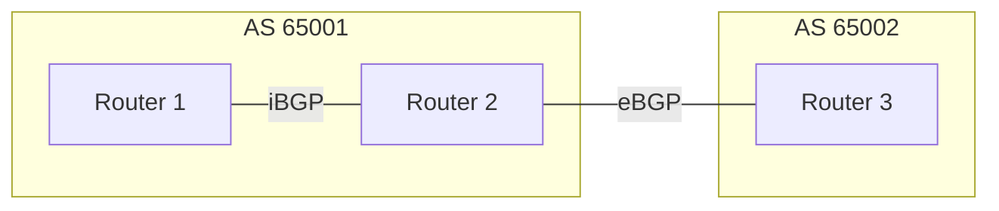
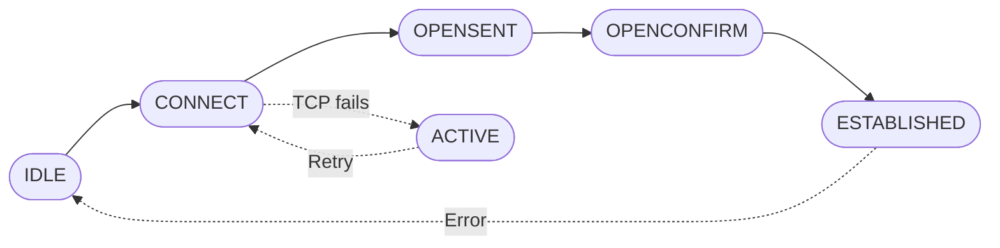

# BGP 101 - Basic Concepts

## What is BGP ?

The _Border Gateway Protocol_ is a key element of the Internet protocol stack. It essentially holds the Internet together by providing a clean mechanism that allows network operators to exchange routing information while enforcing routing policy and exerting control over traffic flows. 

The ultimate goal of BGP is to enable routers to build routing tables that can be used to route traffic over a very large network. These routing tables MUST describe a loop-free topology where paths are optimized by an algorithm (_BGP Best Path_) applying a set of criteria (_attributes_).

## Core ideas behind BGP

We will define a _network_ in this context as a set of devices, links and IPv4/IPv6 prefixes under the _administrative control_ of a single authority. Networks in BGP are identified by an _Autonomous System Number_ (ASN). ASNs were originally 16-bit numbers; since [RFC 6793](https://datatracker.ietf.org/doc/html/rfc6793) they are 32-bit numbers.

BGP-speaking routers ("_bgp speakers_") establish _sessions_ with other bgp speakers. We differentiate between:

- _Internal_ BGP sessions (iBGP) : sessions where both ends of the session belong to the same autonomous system.
- _External_ BGP sessions (eBGP) : sessions where both ends belong to different autonomous systems.

The information distribution policies for both sessions will be different. Both types of sessions are important and will play different key roles as we engineer our network. It is also common for a bgp speaker to host a mix of iBGP and eBGP sessions.

The goal of an established session is to exchange _messages_. Messages are the core functionality of BGP, where routing information is exchanged among peers and then used to build routing tables. 

## On Sessions

A session exists as a TCP connection, normally on port 179. For a session to be correctly established both ends have to be correctly configured. This means, in particular, that if the session is authenticated (TCP-MD5 or TCP-AO) the credentials have to match on both ends, and that each end needs to know beforehand the remote AS number, and this has to be in agreement. 

Imagine that router A, belonging to AS 1, wants to establish a session with router B, which belongs to AS 2. Agreement means that router A "wants to establish a session with a router in AS 2" and router B "wants a session with a router in AS 1".

Sessions go through a lifecycle expressed as a _finite state machine (FSM)_. While we will cover the details in the **BGP Messages** chapter, the general flow is:

As per [RFC 4271](https://datatracker.ietf.org/doc/html/rfc4271), the BGP FSM manages peer relationships through six states (Idle, Connect, Active, OpenSent, OpenConfirm and Established) and only lets routing information flow once the TCP connection is up and both ends have agreed on the session parameters. Established is the final state, where routing information is exchanged.

### The Six BGP States

* Idle (initial state): BGP refuses all incoming connections. When a start event occurs (the session is configured or re-enabled) it initializes its resources, starts the ConnectRetry timer, initiates a TCP connection to the peer and moves to Connect.
* Connect: BGP waits for the TCP connection to complete. If the 3-way handshake succeeds, it sends an OPEN message and moves to OpenSent. If it fails, it moves to Active.
* Active: The TCP connection attempt failed. BGP keeps listening for an incoming connection from the peer and tries again when the ConnectRetry timer expires. A session that stays in this state usually indicates a misconfiguration, such as an incorrect peer IP address, or a network issue.
* OpenSent: The TCP connection is up and BGP has sent its OPEN message. It waits for the peer's OPEN.
* OpenConfirm: BGP received a valid OPEN, answered with a KEEPALIVE, and now waits for the peer's KEEPALIVE.
* Established: The final state, where BGP peers exchange UPDATE, KEEPALIVE, and NOTIFICATION messages.

Several events can make a session go back from ESTABLISHED to IDLE:

- TCP connection reset
- An explicit NOTIFICATION message closing the session
- HoldTimer expiration (the hold timer is reset each time a KEEPALIVE or UPDATE message is received)

#### Common Issues and Transitions

* Stuck in Active: This is a common issue, often caused by improper configuration or connectivity problems that prevent the TCP connection to port 179 from completing.
* Idle Failure: If any error occurs, the BGP session returns to the Idle state.
* Role of TCP: BGP depends on a successfully established TCP connection before it can exchange any BGP message.
* Official Resource: The FSM is specified in detail in [section 8 of RFC 4271](https://datatracker.ietf.org/doc/html/rfc4271#section-8).
