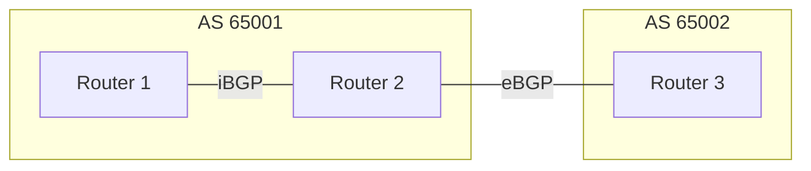
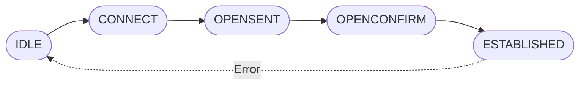

# BGP 101 - Basic Concepts

**Author** Carlos Martinez-Cagnazzo
**Version** 0.1

## What is BGP ?

The _Border Gateway Protocol_ is a key element of the Internet protocol stack. It essentially holds the Internet together by providing a clean mechanism that allows network operators to exchange routing information while enforcing routing policy and exerting control over traffic flows. 

The ultimate goal of BGP is to enable routers to build routing tables that can be used to route traffic over a very large network. These routing tables MUST describe a loop-free topology where paths are optimized by an algorithm (_BGP Best Path_) applying set of criteria (_attributes_).

## Core ideas behind BGP

We will define a _network_ in this context as a set of devices, links and IPv4/IPv6 prefixes under the _administrative control_ of a single authority. Networks in BGP are identified by a 32 bit number called an _Autonomous System Number_.

BGP-speaking routers ("_bgp speakers_") establish _sessions_ with other bgp speakers. We differentiate between:

- _Internal_ BGP sessions (iBGP) : sessions where both ends of the session belong to the same autonomous system.
- _External_ BGP sessions (eBGP) : sessions where both ends belong to different autnomous systems.

The information distribution policies for both sessions will be different.
 Both types of sessions are important and will play different key roles as we engineer our network. It is also common for a bgp speaker to host a mix of iBGP and eBGP sessions.

The goal of a established sessions is to exchange _messages_. Messages are the core functionality of BGP, where routing information is exchanged among peers and then used to build routing tables. 

## On Sessions

A session exists as a TCP connection, normally on port 179. For a session to be correctly established both ends have to be correctly configured. This means, in particular that authentication credentials haver to be correctly configured on both ends and that each end needs to know beforehand the remote as-number and this has to be in agreement. 

Imagine that router A, belonging to as 1, wants to establish a session with router B which belongs to AS 2. Agreement means that router A "wants to establish a session with a router on AS2 and router B a session with AS1".

Sessions go through a lifecycle expressed as a _finite state machine (FSM)_. While we will cover the details in the **BGP Messages** chapter, the general flow is:

**High-Level BGP Session Lifecycle**

As per RFC4271, the BGP Finite State Machine (FSM) manages peer relationships
 through six main states—Idle, Connect, Active, OpenSent, OpenConfirm, and Established—ensuring reliable TCP-based communication. It moves from initial configuration to full exchange via these steps, with Established being the final state where routing information is exchanged. 

### The Six BGP States

* Idle (Initial State): BGP detects a start event and tries to initiate a TCP connection to the peer. It refuses all incoming connections.
* Connect: BGP initiates the TCP connection. If the 3-way handshake succeeds, it moves to OpenSent. If it fails, it moves to Active.
* Active: BGP tries to initiate a TCP session. If it fails to connect, it stays in this state, often indicating a misconfiguration, such as incorrect peer IP addresses, or a network issue.
* OpenSent: The TCP connection is active, and BGP sends an OPEN message to the peer to negotiate parameters.
* OpenConfirm: BGP waits for a KEEPALIVE message to confirm the OPEN message.
* Established: The final state where BGP peers successfully exchange UPDATE, KEEPALIVE, and NOTIFICATION messages. [1, 2, 3, 4, 5, 6] 

Several motives can make a session go back from ESTABLISHED to IDLE:

- TCP connection reset
- A explicit NOTIFICATION message closing the session
- HoldTimer expiration (the hold timer is reset each time a keepalive or an actual message is received)

#### Common Issues and Transitions

* Stuck in Active: This is a common issue often caused by improper configuration or connectivity problems preventing TCP port 179 from opening.
* Idle Failure: If any error occurs, the BGP session returns to the Idle state.
* Role of TCP: As a transport-layer protocol, BGP depends on a successfully established TCP session before any BGP state transition occurs.
* Official Resource: Detailed procedures for the FSM are outlined in the [RFC 1163](https://datatracker.ietf.org/doc/html/rfc1163) 