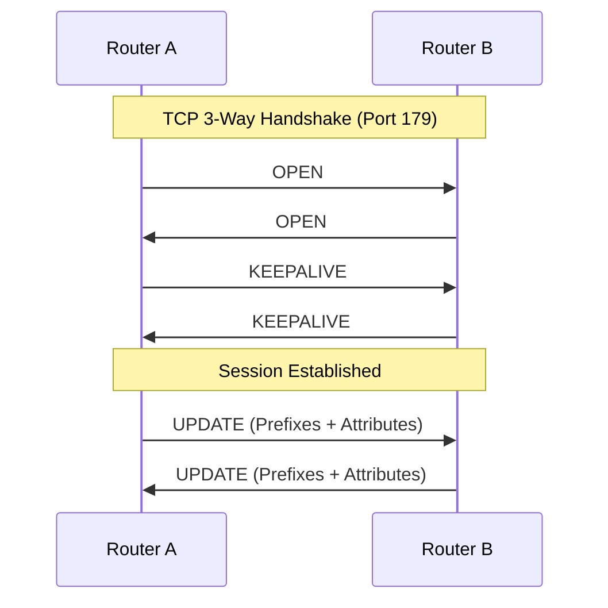
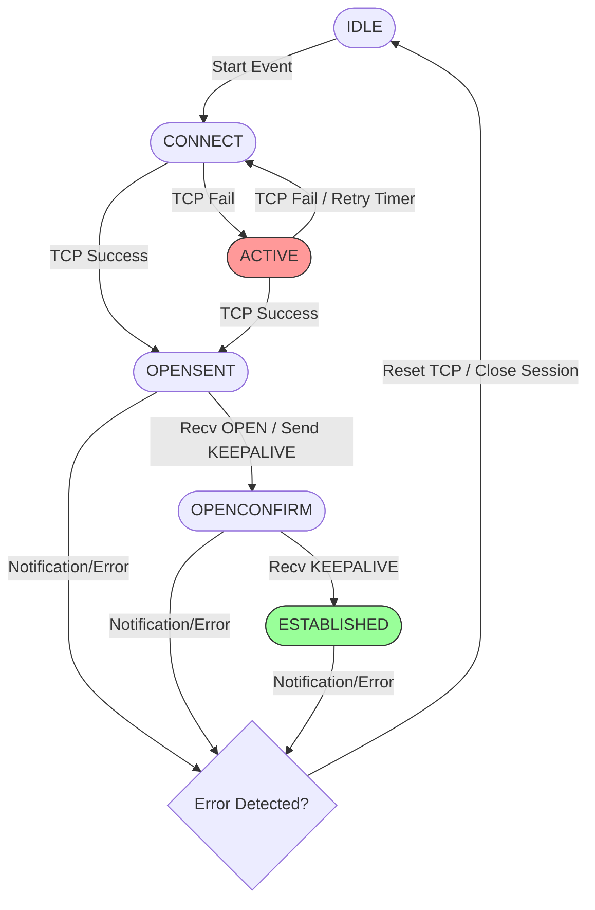
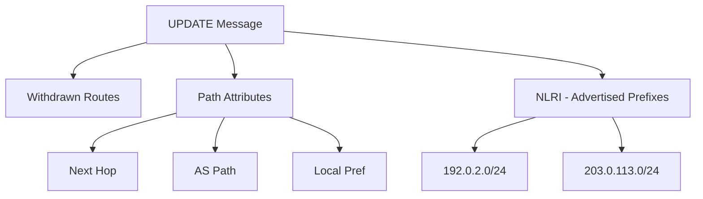

# BGP Messages

BGP-4 uses four message types defined in [RFC 4271](https://datatracker.ietf.org/doc/html/rfc4271) to establish and maintain peer relationships, plus a fifth one, ROUTE-REFRESH, defined in [RFC 2918](https://datatracker.ietf.org/doc/html/rfc2918). All BGP messages share a standard 19-octet header consisting of a Marker (16 bytes), Length (2 bytes), and Type (1 byte).



```
 0                   1                   2                   3
 0 1 2 3 4 5 6 7 8 9 0 1 2 3 4 5 6 7 8 9 0 1 2 3 4 5 6 7 8 9 0 1
+-+-+-+-+-+-+-+-+-+-+-+-+-+-+-+-+-+-+-+-+-+-+-+-+-+-+-+-+-+-+-+-+
|                                                               |
+                                                               +
|                                                               |
+                            Marker                             +
|                          (16 octets)                          |
+                                                               +
|                                                               |
+-+-+-+-+-+-+-+-+-+-+-+-+-+-+-+-+-+-+-+-+-+-+-+-+-+-+-+-+-+-+-+-+
|          Length               |      Type     |
+-+-+-+-+-+-+-+-+-+-+-+-+-+-+-+-+-+-+-+-+-+-+-+-+
```

## BGP Finite State Machine (FSM)

Before we dive into the specific message formats, it is important to understand how these messages drive the lifecycle of a BGP session. The FSM ensures both routers agree on parameters before exchanging routes.



## 1. OPEN (Type 1)
The OPEN message is the first message sent after the TCP 3-way handshake to initiate a BGP session. It includes critical negotiation parameters:

* BGP Version: Must be version 4.
* Autonomous System (AS) Number: Identifies the sender's AS.
* Hold Time: The maximum number of seconds allowed between messages before the session is declared dead. Each side proposes a value and the lower of the two is used.
* BGP Identifier (Router ID): A 32-bit value, written like an IPv4 address, that must be unique for each speaker. It is usually configured explicitly (`bgp router-id` in FRR); otherwise the router picks one of its IPv4 addresses, typically a loopback.
* Optional Parameters: Used to advertise capabilities ([RFC 5492](https://datatracker.ietf.org/doc/html/rfc5492)) such as Multiprotocol BGP (MP-BGP, [RFC 4760](https://datatracker.ietf.org/doc/html/rfc4760)), ROUTE-REFRESH, or 4-byte AS numbers ([RFC 6793](https://datatracker.ietf.org/doc/html/rfc6793)).

## 2. UPDATE (Type 2)
The UPDATE message is used to exchange routing information. A single message can simultaneously advertise and withdraw routes:



* Network Layer Reachability Information (NLRI): Lists the IP prefixes being advertised.
* Path Attributes: Contains metadata for the prefixes (e.g., AS_PATH, NEXT_HOP, LOCAL_PREF) used for path selection.
* Withdrawn Routes: Lists prefixes that are no longer reachable.


```
 0                   1                   2                   3
 0 1 2 3 4 5 6 7 8 9 0 1 2 3 4 5 6 7 8 9 0 1 2 3 4 5 6 7 8 9 0 1
+-+-+-+-+-+-+-+-+-+-+-+-+-+-+-+-+-+-+-+-+-+-+-+-+-+-+-+-+-+-+-+-+
|   Standard BGP Header (Marker, Length, Type=2) - 19 octets    |
+-+-+-+-+-+-+-+-+-+-+-+-+-+-+-+-+-+-+-+-+-+-+-+-+-+-+-+-+-+-+-+-+
|   Withdrawn Routes Length     |
+-+-+-+-+-+-+-+-+-+-+-+-+-+-+-+-+-+-+-+-+-+-+-+-+-+-+-+-+-+-+-+-+
|                                                               |
|              Withdrawn Routes (variable length)               |
|                                                               |
+-+-+-+-+-+-+-+-+-+-+-+-+-+-+-+-+-+-+-+-+-+-+-+-+-+-+-+-+-+-+-+-+
|   Total Path Attribute Length |
+-+-+-+-+-+-+-+-+-+-+-+-+-+-+-+-+-+-+-+-+-+-+-+-+-+-+-+-+-+-+-+-+
|                                                               |
|              Path Attributes (variable length)                |
|                                                               |
+-+-+-+-+-+-+-+-+-+-+-+-+-+-+-+-+-+-+-+-+-+-+-+-+-+-+-+-+-+-+-+-+
|                                                               |
|       Network Layer Reachability Information (NLRI)           |
|               (variable length - advertised routes)           |
|                                                               |
+-+-+-+-+-+-+-+-+-+-+-+-+-+-+-+-+-+-+-+-+-+-+-+-+-+-+-+-+-+-+-+-+
```

It's important to note that a single UPDATE message can advertise multiple prefixes, but they all share the same path attributes.

## 3. NOTIFICATION (Type 3)
A NOTIFICATION message is sent whenever BGP detects an error. Upon sending or receiving this message, the BGP session and underlying TCP connection are immediately closed. It contains:

* Error Code: Major error category: Message Header Error (1), OPEN Message Error (2), UPDATE Message Error (3), Hold Timer Expired (4), Finite State Machine Error (5) or Cease (6).
* Error Subcode: Specific details about the error. For example, Cease subcode 2 is "Administrative Shutdown". The full list is in the [IANA BGP parameters registry](https://www.iana.org/assignments/bgp-parameters/).

## 4. KEEPALIVE (Type 4)

KEEPALIVE messages are sent periodically, usually every third of the Hold Time, to show the peer that the session is alive. RFC 4271 suggests a Hold Time of 90 seconds; Cisco IOS and FRR default to a 60-second keepalive and a 180-second Hold Time. They consist only of the 19-byte header and carry no data. If no Keepalive or Update messages are received within the negotiated Hold Time, the session terminates.

## 5. ROUTE-REFRESH (Type 5)
Defined in [RFC 2918](https://datatracker.ietf.org/doc/html/rfc2918), the ROUTE-REFRESH message allows a router to ask its peer to resend all the routes it advertises for a specific address family, without resetting the session. This is commonly used to apply new inbound routing policies non-disruptively.

