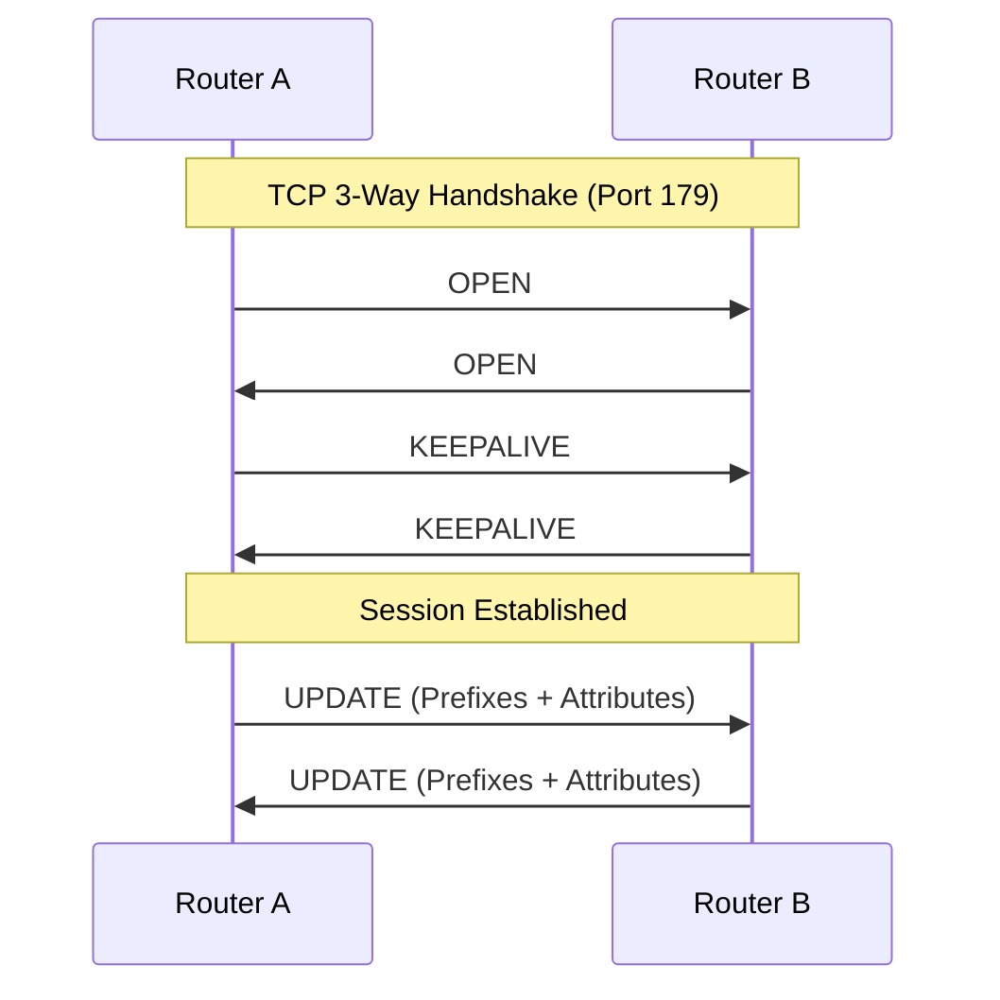
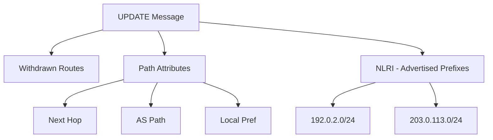

# BGP Messages

BGP-4 utilizes four primary message types
 defined in [RFC 4271](https://datatracker.ietf.org/doc/html/rfc4271) to establish and maintain peer relationships, along with a fifth common type for route management. All BGP messages share a standard 19-octet header consisting of a Marker (16 bytes), Length (2 bytes), and Type (1 byte). [1, 2, 3, 4] 



```
 0                   1                   2                   3
 0 1 2 3 4 5 6 7 8 9 0 1 2 3 4 5 6 7 8 9 0 1 2 3 4 5 6 7 8 9 0 1
+-+-+-+-+-+-+-+-+-+-+-+-+-+-+-+-+-+-+-+-+-+-+-+-+-+-+-+-+-+-+-+-+

|                                                               |
+                                                               +

|                                                               |
+                            Marker                             +

|                          (16 octets)                          |
+                                                               +

|                                                               |
+-+-+-+-+-+-+-+-+-+-+-+-+-+-+-+-+-+-+-+-+-+-+-+-+-+-+-+-+-+-+-+-+

|          Length               |      Type     |
+-+-+-+-+-+-+-+-+-+-+-+-+-+-+-+-+-+-+-+-+-+-+-+-+
```

## BGP Finite State Machine (FSM)

Before we dive into the specific message formats, it is important to understand how these messages drive the lifecycle of a BGP session. The FSM ensures both routers agree on parameters before exchanging routes.


## 1. OPEN (Type 1)
The OPEN message is the first message sent after the TCP 3-way handshake to initiate a BGP session. It includes critical negotiation parameters: [5, 6, 7, 8] 

* BGP Version: Must be version 4.
* Autonomous System (AS) Number: Identifies the sender's AS.
* Hold Time: The maximum seconds allowed between messages before a session is declared dead.
* BGP Identifier (Router ID): Typically the router's highest loopback IP.
* Optional Parameters: Used to negotiate capabilities like Multiprotocol BGP (MP-BGP) or 4-byte AS numbers. [1, 2, 6, 9, 10] 

## 2. UPDATE (Type 2)
The UPDATE message is used to exchange routing information. A single message can simultaneously advertise and withdraw routes: [2, 5] 



* Network Layer Reachability Information (NLRI):
 Lists the IP prefixes being advertised.
* Path Attributes: Contains metadata for the prefixes (e.g., AS_PATH, NEXT_HOP, LOCAL_PREF) used for path selection.
* Withdrawn Routes: Lists prefixes that are no longer reachable. [2, 6, 10] 


```
 0                   1                   2                   3
 0 1 2 3 4 5 6 7 8 9 0 1 2 3 4 5 6 7 8 9 0 1 2 3 4 5 6 7 8 9 0 1
+-+-+-+-+-+-+-+-+-+-+-+-+-+-+-+-+-+-+-+-+-+-+-+-+-+-+-+-+-+-+-+-+

|   Standard BGP Header (Marker, Length, Type=2) - 19 octets    |
+-+-+-+-+-+-+-+-+-+-+-+-+-+-+-+-+-+-+-+-+-+-+-+-+-+-+-+-+-+-+-+-+

|   Unfeasible Routes Length    |
+-+-+-+-+-+-+-+-+-+-+-+-+-+-+-+-+-+-+-+-+-+-+-+-+-+-+-+-+-+-+-+-+

|                                                               |
|              Withdrawn Routes (variable length)               |
|                                                               |
+-+-+-+-+-+-+-+-+-+-+-+-+-+-+-+-+-+-+-+-+-+-+-+-+-+-+-+-+-+-+-+-+

|   Total Path Attribute Length |
+-+-+-+-+-+-+-+-+-+-+-+-+-+-+-+-+-+-+-+-+-+-+-+-+-+-+-+-+-+-+-+-+

|                                                               |
|              Path Attributes (variable length)                |
|                                                               |
+-+-+-+-+-+-+-+-+-+-+-+-+-+-+-+-+-+-+-+-+-+-+-+-+-+-+-+-+-+-+-+-+

|                                                               |
|       Network Layer Reachability Information (NLRI)           |
|               (variable length - advertised routes)           |
|                                                               |
+-+-+-+-+-+-+-+-+-+-+-+-+-+-+-+-+-+-+-+-+-+-+-+-+-+-+-+-+-+-+-+-+

```

It's important to not that a single UPDATE message can advertise multiple prefixes but they all share the same path attributes.

## 3. NOTIFICATION (Type 3)
A NOTIFICATION message is sent whenever BGP detects an error. Upon sending or receiving this message, the BGP session and underlying TCP connection are immediately closed. It contains: [4, 5, 11] 

* Error Code: Major error category (e.g., Hold Timer expired, Message Header error).
* Error Subcode: Specific details about the error. [3, 6] 

## 4. KEEPALIVE (Type 4) [3] 

KEEPALIVE messages are sent periodically (default 60 seconds) to ensure the peer is still active. They consist only of the 19-byte header and carry no data. If no Keepalive or Update messages are received within the negotiated Hold Time, the session terminates. [1, 2, 10, 11, 12] 

## 5. ROUTE-REFRESH (Type 5) [13] 
Defined in [RFC 2918](https://datatracker.ietf.org/doc/html/rfc2918), the ROUTE-REFRESH message allows a router to request its peer to resend its full routing table for a specific address family without resetting the session. This is commonly used to apply new inbound routing policies non-disruptively. [14, 15, 16] 

[1] [https://support.huawei.com](https://support.huawei.com/enterprise/en/doc/EDOC1100459015/dd215540/bgp-message-format)
[2] [https://networklessons.com](https://networklessons.com/bgp/bgp-messages)
[3] [https://www.iana.org](https://www.iana.org/assignments/bgp-parameters#:~:text=Table_title:%20BGP%20Message%20Types%20Table_content:%20header:%20%7C,6%2D255%20%7C%20Name:%20Unassigned%20%7C%20Reference:%20%7C&text=Table_title:%20BGP%20Error%20%28Notification%29%20Codes%20Table_content:%20header:,10%2D255%20%7C%20Name:%20Unassigned%20%7C%20Reference:%20%7C)
[4] [https://ipcisco.com](https://ipcisco.com/lesson/bgp-peers-bgp-sessions-bgp-messages/)
[5] [https://support.huawei.com](https://support.huawei.com/enterprise/en/doc/EDOC1100334538/a0c4ad3c/understanding-bgp)
[6] [https://flylib.com](https://flylib.com/books/en/2.295.1.29/1/)
[7] [https://www.vervecopilot.com](https://www.vervecopilot.com/interview-questions/top-30-most-common-bgp-interview-questions-you-should-prepare-for#:~:text=It%20%28%20The%20OPEN%20message%20%29%20%27s,to%20start%20a%20conversation%20without%20introducing%20yourself.)
[8] [https://www.naukri.com](https://www.naukri.com/code360/library/introduction-to-border-gateway-protocol-bgp#:~:text=Initialization:%20BGP%20routers%20establish%20a%20TCP%20connection%2C%20exchange%20open%20messages%2C%20and%20negotiate%20parameters.)
[9] [https://networklessons.com](https://networklessons.com/bgp/bgp-messages)
[10] [https://www.scribd.com](https://www.scribd.com/document/528864213/10-BGP-Messages)
[11] [https://stormwall.network](https://stormwall.network/resources/terms/protocols/bgp)
[12] [https://support.huawei.com](https://support.huawei.com/enterprise/en/doc/EDOC1100278983/a0c4ad3c/understanding-bgp)
[13] [https://www.ciscopress.com](https://www.ciscopress.com/articles/article.asp?p=2738462&seqNum=2#:~:text=There%20is%20a%20fifth%20BGP%20message%20type:,its%20use%20are%20described%20in%20Chapter%204.)
[14] [https://pike.lysator.liu.se](https://pike.lysator.liu.se/docs/ietf/rfc/29/rfc2918.xml)
[15] [https://support.huawei.com](https://support.huawei.com/enterprise/en/doc/EDOC1000089038/b38b2b8e/bgp-working-principles)
[16] [https://documentation.nokia.com](https://documentation.nokia.com/acg/25-3-2/books/unicast-routing-protocols-classic/c221-bgp-route-refresh.html)
