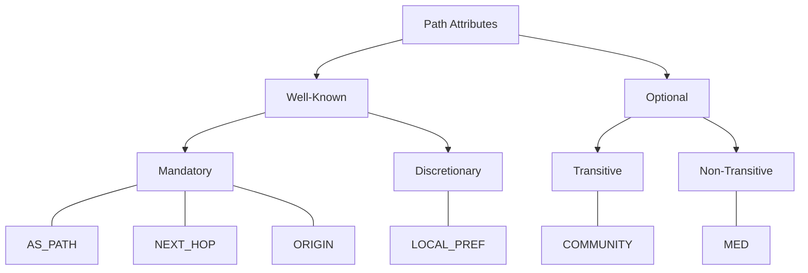
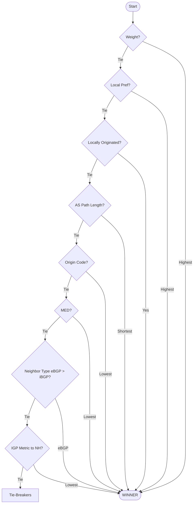

# Path Attributes and BGP Best Path Selection

## Path Attributes

Path attributes are the "tags" or metadata attached to NLRI (prefixes) within a BGP UPDATE message. BGP uses these attributes to determine the best path to a destination and to detect routing loops.

They are categorized into four types:

- Well-known Mandatory (must be supported and present), 
- Well-known Discretionary (must be supported, may be present), 
- Optional Transitive (passed along even if not understood), 
- Optional Non-transitive (discarded if not understood).

Attributes are communicated through the UPDATE message and applied by each bgp speaker locally to determine the best paths to each destination.

Below follows a list of the most used and important attributes.

### 1. AS_PATH (Well-known Mandatory)

* What it is: A list of all Autonomous System numbers a route has passed through.
* Role: It is used for loop prevention (if a router sees its own AS in the list, it drops the update) and path selection (shorter AS_PATHs are generally preferred).

### 2. NEXT_HOP (Well-known Mandatory)

* What it is: The IP address of the router used to reach the advertised prefixes.
* Role: For eBGP, this is typically the IP of the neighbor; for iBGP, it usually remains the IP of the original eBGP exit point unless "next-hop-self" is configured.

### 3. ORIGIN (Well-known Mandatory)

* What it is: Defines where the route came from.
* Values:
   * IGP (`i`, code 0): The route was originated inside the AS, e.g., with a `network` command.
   * EGP (`e`, code 1): Learned via the Exterior Gateway Protocol (historic, rarely seen).
   * Incomplete (`?`, code 2): Unknown origin, e.g., redistributed from another protocol.

### 4. LOCAL_PREF (Well-known Discretionary)

* What it is: A value telling routers within an AS which path is preferred to exit the AS.
* Role: Higher is better (default 100). It is only exchanged over iBGP sessions, never sent to eBGP peers; it stays internal to your network.

### 5. MULTI_EXIT_DISC / MED (Optional Non-transitive)

* What it is: A hint sent to an external neighbor about the preferred entry point into your AS.
* Role: Lower is better. Unlike Local Pref, this is used to influence inbound traffic from a neighbor. It is not passed on beyond the neighboring AS, and by default routers only compare MEDs between paths received from the same neighboring AS.

### 6. COMMUNITY (Optional Transitive)

* What it is: A numerical tag used to group routes for administrative purposes.
* Role: Used to trigger specific routing policies (e.g., "don't advertise this to Peer X" or "set Local Pref to 200").

## BGP Best Path Selection Algorithm

BGP routers often receive multiple paths to the same destination. To pick the single "best" path to install in the routing table, BGP follows a strict, step-by-step tie-breaker list.
The algorithm stops at the first step where one path is clearly superior to the others.

### The BGP Best Path Selection Hierarchy

   1. Weight (vendor-specific, supported by Cisco and FRR): Highest weight is preferred. It is not a BGP attribute: it is local to the router and never advertised to any peers.
   2. Local Preference: Highest Local Preference is preferred. This is used to choose the exit point from your local AS.
   3. Locally Originated: Prefer paths that were locally originated (via network or aggregate commands) over those learned from a peer.
   4. AS_PATH Length: Shortest AS_PATH is preferred. Each AS number the route passes through adds "length."
   5. Origin Type: Lowest origin code is preferred: IGP < EGP < Incomplete.
   6. Multi-Exit Discriminator (MED): Lowest MED is preferred, comparing only paths from the same neighboring AS. This is typically used by a neighbor to influence how you enter its AS.
   7. Neighbor Type: Prefer eBGP paths over iBGP paths.
   8. IGP Metric to Next Hop: Prefer the path with the lowest internal gateway protocol (OSPF/IS-IS/EIGRP) metric to the BGP NEXT_HOP.

### Tie-Breakers (If everything above is equal)

If the paths are still identical after the main checks, BGP uses these final "last resort" steps:

   9. Oldest Path: For eBGP paths, prefer the one that was received first (the most stable).
   10. Lowest Router ID: Prefer the path from the neighbor with the lowest BGP Router ID (for reflected routes, the ORIGINATOR_ID is used instead).
   11. Shortest CLUSTER_LIST: Prefer the path that went through fewer route reflectors.
   12. Lowest Neighbor IP: If the same router is reachable over several sessions, prefer the path from the lowest neighbor IP address.

The exact list and order vary slightly between implementations. FRR documents its own in the [BGP route selection](https://docs.frrouting.org/en/latest/bgp.html#route-selection) section of its manual, and `show ip bgp <prefix>` tells you why a path won.

### Pro-Tip: Memory Hook
A common mnemonic to remember the main steps is **W**e **L**ove **O**range **A**s **O**ur **M**other **E**ats **I**ce-cream:

* Weight
* Local Pref
* Originated locally
* AS_Path
* Origin Code
* MED
* External (eBGP)
* IGP metric
