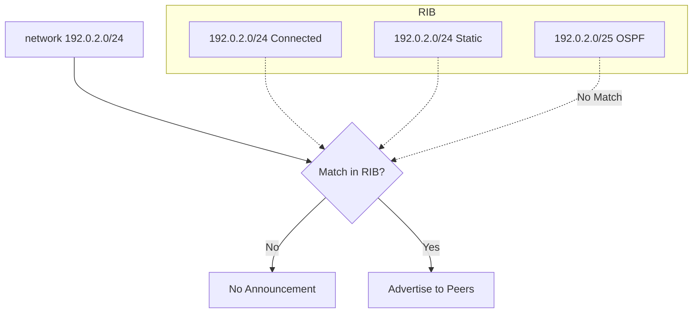
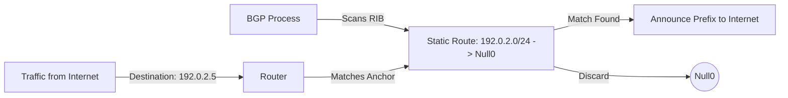
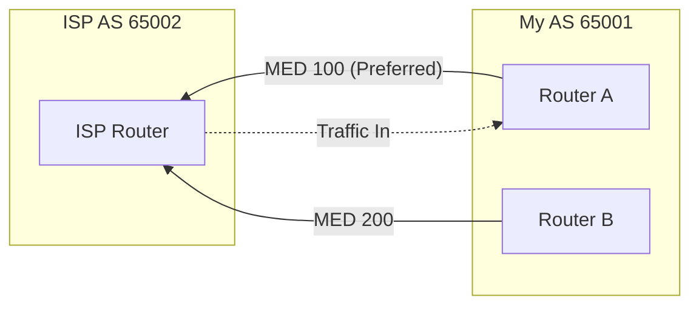

# Announcing My Routes to the World Using BGP

In previous chapters, we looked at how to establish sessions and how BGP selects the best path. Now, we will focus on how to actually tell the world about the prefixes we own. BGP is a very conservative protocol; it will not announce anything unless specifically told to do so, and even then, certain conditions must be met.

## Multiprotocol BGP and Address Families

Modern BGP is "Multiprotocol" (MP-BGP). This means it can carry routing information for different types of addresses (IPv4, IPv6, VPNs, etc.) over the same session. To manage this, we use **Address Families**.

In the past, BGP configuration was flat. Today, we define the neighbor globally but activate specific capabilities and prefixes within an `address-family` block. The examples in this course use FRR syntax, which is very close to Cisco IOS.

```text
router bgp 65001
 neighbor 2001:db8:acad::2 remote-as 65002
 !
 address-family ipv4 unicast
  neighbor 2001:db8:acad::2 activate
  network 192.0.2.0/24
 exit-address-family
 !
 address-family ipv6 unicast
  neighbor 2001:db8:acad::2 activate
  network 2001:db8:beef::/48
 exit-address-family
```
*Note: You can carry IPv4 prefixes over an IPv6 peering session (and vice versa). Dual-stack networks often do this on iBGP sessions; on eBGP, separate IPv4 and IPv6 sessions are more common. Lab 2 shows both.*

---

## The `network` Command

The `network` command tells BGP: *"If you have this exact prefix in your routing table, announce it to my peers."*

### The "Exact Match" Rule
For the `network` command to work, the prefix and its mask must match an entry in the IP routing table (RIB) **exactly**. If the route disappears from the RIB, BGP withdraws the announcement.



**IPv4 Example:**
```text
address-family ipv4 unicast
 network 192.0.2.0/24
```
Cisco IOS writes the same command as `network 192.0.2.0 mask 255.255.255.0`; FRR accepts both forms.

**IPv6 Example:**
```text
address-family ipv6 unicast
 network 2001:db8:beef::/48
```

---

## Anchoring Routes: The "Pull-up" Route

To satisfy the "Exact Match" rule when you don't have a specific interface for a block, we use a **pull-up** route pointing to a discard interface.



### Cisco IOS Example

```text
ip route 192.0.2.0 255.255.255.0 Null0
ipv6 route 2001:db8:beef::/48 Null0
```

### FRR Note: The Blackhole Route
In FRR, use the `blackhole` keyword:
```text
ip route 192.0.2.0/24 blackhole
ipv6 route 2001:db8:beef::/48 blackhole
```

---

## Historical Context: BGP Synchronization

**The Rule:** Do not advertise an iBGP route to an eBGP peer unless the IGP also knows about it.

**Status:** Obsolete. Cisco IOS disabled it by default long ago (`no synchronization`), and FRR doesn't implement it: today's networks carry external routes in iBGP (full mesh or route reflectors) or use MPLS, not in the IGP.

---

## Redistributing IGPs into BGP

Redistribution pulls routes from OSPF, IS-IS, or Connected interfaces into BGP automatically. This must be done inside the correct address family. In FRR, IPv6 routes come from OSPFv3, which is `ospf6`:

```text
address-family ipv6 unicast
 redistribute ospf6
```

### Risks: Instability and Leaks
1.  **Leaking Internal Routes:** You might announce private `/32` or `/128` loopbacks.
2.  **Route Flapping:** Internal link issues can cause global BGP instability.

### Control with Route-Maps
```text
ipv6 prefix-list MY-V6-BLOCK permit 2001:db8:beef::/48
!
route-map OSPF-TO-BGP-V6 permit 10
 match ipv6 address prefix-list MY-V6-BLOCK
!
router bgp 65001
 address-family ipv6 unicast
  redistribute ospf6 route-map OSPF-TO-BGP-V6
```

---

## Influencing Inbound Traffic: The MED

The **Multi-Exit Discriminator (MED)** is a metric sent to eBGP peers to "suggest" an entry point. **Lower is preferred.**



```text
route-map SET-MED-LOW permit 10
 set metric 100

router bgp 65001
 address-family ipv4 unicast
  neighbor 10.0.0.2 route-map SET-MED-LOW out
```

---

## Troubleshooting and Verification

When things don't work, you need to check the RIB, the BGP Table, and the Neighbor state.

### 1. Verification Commands

*   `show ip bgp` (or `show bgp ipv6 unicast`): Shows the BGP table. Look for the `*` (valid) and `>` (best) symbols.
*   `show ip route`: Checks the main routing table to see if your "Exact Match" or "Anchor" exists.
*   `show ip bgp neighbors <IP> advertised-routes`: Checks exactly what you are sending to a peer.
*   `show ip bgp neighbors <IP> routes`: Checks what you are receiving from a peer.

### 2. Clearing the Session (The "Hammer")

If you change a policy (like a route-map), many implementations, such as Cisco IOS, don't apply it to routes they already have. You need to reset the session.

*   **Hard Reset:** `clear ip bgp *`
    *   **Effect:** Drops the TCP sessions and every route learned over them. Traffic is disrupted until the sessions come back and the routes are learned again, which can take minutes with a full Internet table. **Never do this in production unless necessary.**

*   **Soft Reset:** `clear ip bgp <neighbor> soft out` (or `in`), or `clear ip bgp * soft` for both directions and all neighbors.
    *   **Effect:** `soft out` re-sends your updates to the peer through your current outbound policy. `soft in` asks the peer to re-send its routes (ROUTE-REFRESH) and runs them through your current inbound policy. The session stays up and there is no traffic loss.

FRR re-applies policy automatically: a few seconds after you edit a route-map or prefix-list in use, or attach a route-map to a neighbor, it re-evaluates the affected routes. Soft resets are still useful in FRR after other changes, such as `no bgp ebgp-requires-policy` (Lab 1).

### 3. Soft Reconfiguration Inbound

If a neighbor doesn't support ROUTE-REFRESH, you can use `soft-reconfiguration inbound`.

```text
neighbor 10.0.0.2 soft-reconfiguration inbound
```

*   **Advantage:** Allows you to see the "raw" routes received from a neighbor before any of your filters are applied (`show ip bgp neighbors 10.0.0.2 received-routes`).
*   **Disadvantage:** Memory intensive. The router has to store a second copy of every route the neighbor sends, which can be millions of prefixes on the full Internet table.

---

## Summary Checklist
- [ ] Are the correct **Address Families** activated?
- [ ] Does the prefix exist in the RIB? (Exact Match/Anchor)
- [ ] If using redistribution, is it filtered?
- [ ] Have the new policies been applied (automatically in FRR, with a soft reset elsewhere)?
