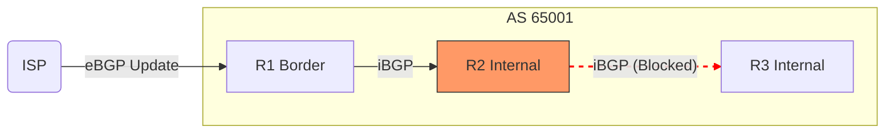
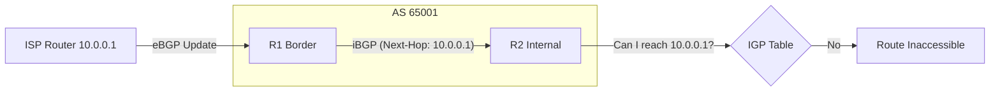
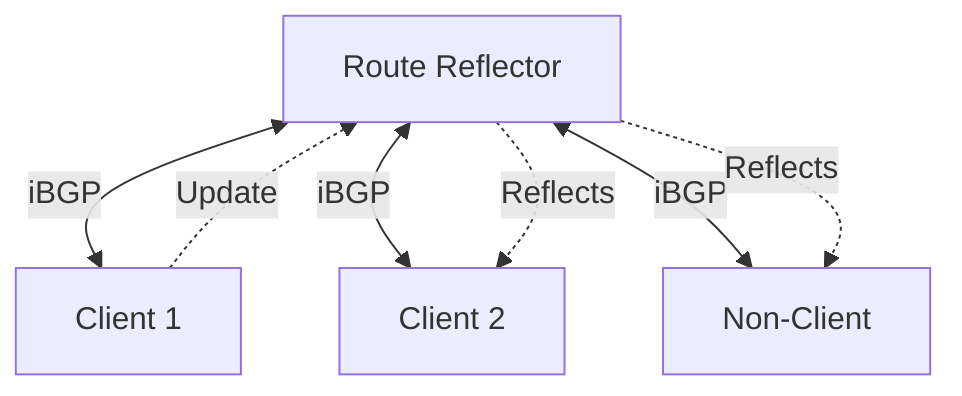

# iBGP Mechanics and Internal Propagation

In previous chapters, we focused mostly on eBGP (External BGP) to connect different Autonomous Systems. However, most networks have more than one BGP router. How these internal routers share BGP information is the realm of **Internal BGP (iBGP)**.

iBGP is not just "BGP between friends"; it has very specific rules that differ from eBGP to prevent loops and ensure stability.

## 1. Peering on Loopbacks

In eBGP, we usually peer using the IP addresses of the physical link connecting the two routers. In iBGP, we almost always peer using **Loopback interfaces**.

### Why?
If a physical link between two internal routers fails, but there is another path through the network (OSPF/IS-IS), the BGP session should stay up. Since a Loopback interface never goes down unless the router itself fails, it provides a stable anchor for the TCP session.

**The `update-source` command:**
When peering with a Loopback, you must tell BGP to use that Loopback's IP as the source of its BGP packets. Otherwise, the packets leave from the outgoing interface's address, which doesn't match the neighbor address configured on the other end, and the connection is rejected. In FRR, the loopback interface is `lo` (Cisco IOS calls it `Loopback0`).

```text
router bgp 65001
 neighbor 10.255.0.1 remote-as 65001
 neighbor 10.255.0.1 update-source lo
```

---

## 2. The iBGP Split-Horizon Rule

This is the most important rule in iBGP:

> **"A route learned from an iBGP peer is not advertised to other iBGP peers."**

(Route reflectors, covered below, are the controlled exception.)



### The Reason
In eBGP, we use the `AS_PATH` to detect loops. If we see our own AS in the path, we reject the route. However, inside an AS, the `AS_PATH` doesn't change. Without this Split-Horizon rule, a route could loop forever inside the AS.

### The Consequence: Full Mesh
Because of Split-Horizon, every iBGP router must have a direct session with **every other** iBGP router in the AS to ensure everyone sees all routes. 
*   3 routers = 3 sessions
*   10 routers = 45 sessions
*   100 routers = 4,950 sessions! (This doesn't scale well).

---

## 3. The Next-Hop Behavior (The #1 iBGP Issue)

By default, BGP **does not change the Next-Hop attribute** when sending a route to an iBGP peer.



### The Problem
If Router A (eBGP) receives a route from an ISP and sends it to Router B (iBGP), the Next-Hop remains the IP of the ISP's router. If Router B doesn't have a route to that ISP's IP in its IGP (OSPF), it will mark the BGP route as **"Invalid"** or **"Inaccessible"** and won't use it. Lab 2 shows what this looks like.

### The Solution: `next-hop-self`
We tell the border router to change the Next-Hop to its own Loopback IP before sending it to internal peers.

```text
router bgp 65001
 address-family ipv4 unicast
  neighbor 10.255.0.2 next-hop-self
```

---

## 4. TTL Differences

*   **eBGP:** Packets are sent with a Time-to-Live (TTL) of **1**. This assumes the neighbor is directly connected. (Peering on eBGP loopbacks requires `ebgp-multihop`).
*   **iBGP:** Packets are sent with a TTL of **255**. iBGP peers can be many hops away as long as there is IGP reachability.

---

## 5. Scaling iBGP: Route Reflectors

Since a Full Mesh is impossible in large networks, we use **Route Reflectors (RR)** to "break" the Split-Horizon rule safely.



A Route Reflector ([RFC 4456](https://datatracker.ietf.org/doc/html/rfc4456)) is a router allowed to re-advertise iBGP routes to other iBGP peers. Its iBGP peers are either *clients* or *non-clients*, and it reflects routes according to where they came from:

*   **From a client:** reflected to all clients and non-clients.
*   **From a non-client:** reflected to clients only.
*   **From an eBGP peer:** sent to everyone, as usual.

The clients need no special configuration: they peer with the RR like with any iBGP neighbor. To prevent loops, the RR adds two special attributes:
1.  **ORIGINATOR_ID:** The Router ID of the router that first sent the route.
2.  **CLUSTER_LIST:** A list of RRs the route has passed through.

### RR Configuration Example
Only the Route Reflector needs special configuration:

```text
router bgp 65001
 neighbor 10.255.0.2 remote-as 65001
 address-family ipv4 unicast
  neighbor 10.255.0.2 route-reflector-client
```

---

## Summary Comparison

| Feature | eBGP | iBGP |
| :--- | :--- | :--- |
| **AS Number** | Different | Same |
| **TTL** | 1 (default) | 255 |
| **Next-Hop** | Changes to self | Does not change (by default) |
| **Propagation** | Advertises its best paths to every peer | Does not re-advertise iBGP to iBGP (except RRs) |
| **Loop Prevention** | AS_PATH | Split-Horizon (ORIGINATOR_ID and CLUSTER_LIST with RRs) |

## Troubleshooting Checklist
- [ ] Is the `update-source` set to the Loopback?
- [ ] Does the IGP (OSPF/Static) have a route to the neighbor's Loopback?
- [ ] Is `next-hop-self` configured on the border routers?
- [ ] If not using a full mesh, is a Route Reflector configured?
