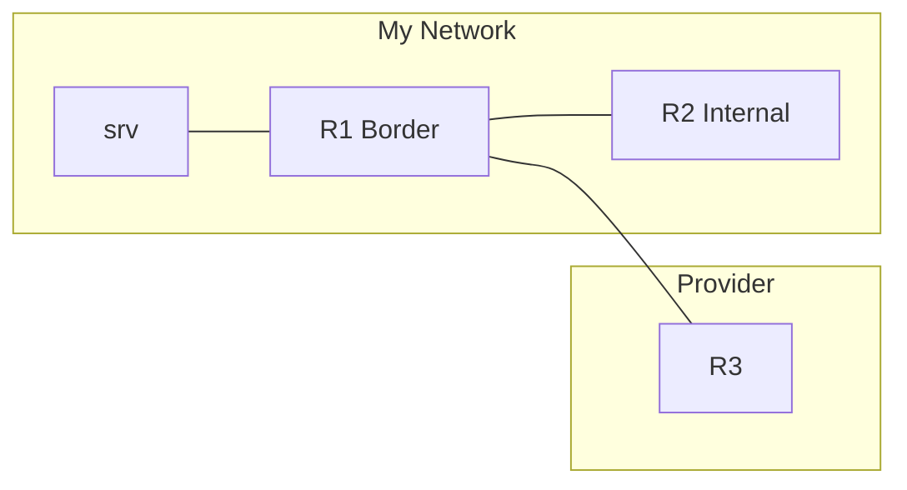

# Lab 2 - iBGP, MP-BGP, and Route Origination

## Objectives
- Establish an iBGP session using Loopback interfaces.
- Originate IPv4 and IPv6 prefixes using the `network` command and "Anchoring".
- Observe and fix the iBGP Next-Hop issue using `next-hop-self`.
- Perform controlled redistribution of connected networks into BGP.
- Apply a policy change and watch it propagate without resetting the session.

## Topology & Addressing
We will use a 3-router topology in Containerlab, plus a server on R1's "Lab-Services" LAN. You operate R1 and R2 (AS 65000). R3 is your provider (AS 65001) and is already configured, and so is the server.



| Device  | Interface    | IPv4 Address    | IPv6 Address         | BGP Role          |
| :------ | :----------- | :-------------- | :------------------- | :---------------- |
| **R1**  | lo           | 10.255.0.1/32   | 2001:db8:ffff::1/128 | AS 65000 Border   |
| **R1**  | eth1 (to R2) | 10.0.12.1/24    | 2001:db8:12::1/64    | -                 |
| **R1**  | eth2 (to R3) | 10.0.13.1/24    | 2001:db8:13::1/64    | -                 |
| **R1**  | eth3 (LAN)   | 172.16.1.1/24   | -                    | -                 |
| **R2**  | lo           | 10.255.0.2/32   | 2001:db8:ffff::2/128 | AS 65000 Internal |
| **R2**  | eth1 (to R1) | 10.0.12.2/24    | 2001:db8:12::2/64    | -                 |
| **R3**  | eth1 (to R1) | 10.0.13.3/24    | 2001:db8:13::3/64    | AS 65001 Provider |
| **srv** | eth1         | 172.16.1.10/24  | -                    | -                 |

R3 announces `198.51.100.0/24` and `2001:db8:cafe::/48` to you.

---

## Deployment
Use the provided `lab-2.clab.yml` to start the topology (see "Working with the Lab Environment" in Lab 1):
```bash
cd labs/lab-2
sudo containerlab deploy
docker exec -it clab-bgp101-lab2-r1 vtysh
```

---

## Task 0: Interface and Loopback Configuration
The interfaces are addressed when the lab starts. In FRR, the loopback is the interface `lo` and is configured like any other interface. Check R1:

```text
r1# show running-config
...
interface lo
 ip address 10.255.0.1/32
 ipv6 address 2001:db8:ffff::1/128
exit
r1# show interface brief
```

---

## Task 1: The Internal Foundation (IGP)
Before BGP, our internal routers must know how to reach each other's Loopbacks. We will use static routes for simplicity in this lab; a real network would run an IGP such as OSPF or IS-IS. Remember that reachability must work **in both directions**.

### Configuration (R1)
```text
ip route 10.255.0.2/32 10.0.12.2
ipv6 route 2001:db8:ffff::2/128 2001:db8:12::2
```

### Configuration (R2)
```text
ip route 10.255.0.1/32 10.0.12.1
ipv6 route 2001:db8:ffff::1/128 2001:db8:12::1
```

### Verification
Ensure you can ping R2's loopback from R1's loopback:
```text
$ docker exec clab-bgp101-lab2-r1 ping -c 2 -I 10.255.0.1 10.255.0.2
2 packets transmitted, 2 packets received, 0% packet loss
$ docker exec clab-bgp101-lab2-r1 ping -c 2 -I 2001:db8:ffff::1 2001:db8:ffff::2
2 packets transmitted, 2 packets received, 0% packet loss
```

---

## Task 2: Establishing iBGP over Loopbacks
Now we establish the BGP session. We must specify the `update-source` so that the TCP session uses the Loopback address. A single session over IPv4 will carry both address families: IPv4 unicast is active by default, and we activate IPv6 unicast explicitly.

### Configuration (R1)
```text
router bgp 65000
 bgp router-id 10.255.0.1
 neighbor 10.255.0.2 remote-as 65000
 neighbor 10.255.0.2 update-source lo
 !
 address-family ipv6 unicast
  neighbor 10.255.0.2 activate
 exit-address-family
```

Configure R2 the same way, with router ID `10.255.0.2` and neighbor `10.255.0.1`.

### Verification
Check the session state:
```text
r1# show bgp summary

IPv4 Unicast Summary:
...
Neighbor        V         AS   MsgRcvd   MsgSent   TblVer  InQ OutQ  Up/Down State/PfxRcd   PfxSnt Desc
10.255.0.2      4      65000         4         4        0    0    0 00:00:08            0        0 N/A

IPv6 Unicast Summary:
...
Neighbor        V         AS   MsgRcvd   MsgSent   TblVer  InQ OutQ  Up/Down State/PfxRcd   PfxSnt Desc
10.255.0.2      4      65000         4         4        0    0    0 00:00:08            0        0 N/A
```
*Expected Result: The State/PfxRcd column should show a number (e.g., 0), not "Active", "Connect" or "Idle".*

Since this is an iBGP session, FRR's eBGP policy requirement (Lab 1) doesn't apply.

---

## Task 3: Originating Prefixes (The Anchor)
We will announce `192.0.2.0/24` and `2001:db8:beef::/48`. Neither exists on any interface, so we anchor them with blackhole routes first.

### Configuration (R1)
```text
ip route 192.0.2.0/24 blackhole
ipv6 route 2001:db8:beef::/48 blackhole
!
router bgp 65000
 address-family ipv4 unicast
  network 192.0.2.0/24
 exit-address-family
 !
 address-family ipv6 unicast
  network 2001:db8:beef::/48
 exit-address-family
```

### Verification
Check that R2 receives both prefixes:
```text
r2# show ip bgp
...
     Network          Next Hop            Metric LocPrf Weight Path
 *>i 192.0.2.0/24     10.255.0.1               0    100      0 i

r2# show bgp ipv6 unicast 2001:db8:beef::/48
BGP routing table entry for 2001:db8:beef::/48, version 1
Paths: (1 available, best #1, table default)
  Not advertised to any peer
  Local
    2001:db8:ffff::1 from 10.255.0.1 (10.255.0.1)
      Origin IGP, metric 0, localpref 100, valid, internal, best (First path received)
```
*Expected Result: The `*>` symbols indicate the route is Valid and Best, and the `i` that it was learned via iBGP. Note that the IPv6 prefix, although carried over an IPv4 session, has an IPv6 next hop: R1's loopback.*

**Try it:** remove the blackhole route for `192.0.2.0/24` and look at R2 again. What happens to the announcement? Put the route back when you're done.

---

## Task 4: Solving the Next-Hop Issue
Now connect R1 to the provider. Configure one eBGP session over IPv4 for IPv4 prefixes and one over IPv6 for IPv6 prefixes. As in Lab 1, we disable the eBGP policy requirement for now.

### Configuration (R1)
```text
router bgp 65000
 no bgp ebgp-requires-policy
 neighbor 10.0.13.3 remote-as 65001
 neighbor 2001:db8:13::3 remote-as 65001
 !
 address-family ipv4 unicast
  no neighbor 2001:db8:13::3 activate
 exit-address-family
 !
 address-family ipv6 unicast
  neighbor 2001:db8:13::3 activate
 exit-address-family
```

### Observation (on R2)
R3 sends `198.51.100.0/24`. Check the route on the internal router:
```text
r2# show ip bgp
...
     Network          Next Hop            Metric LocPrf Weight Path
 *>i 192.0.2.0/24     10.255.0.1               0    100      0 i
   i 198.51.100.0/24  10.0.13.3                0    100      0 65001 i

r2# show ip bgp 198.51.100.0/24
BGP routing table entry for 198.51.100.0/24, version 0
Paths: (1 available, no best path)
  Not advertised to any peer
  65001
    10.0.13.3 (inaccessible, import-check enabled) from 10.255.0.1 (10.255.0.1)
      Origin IGP, metric 0, localpref 100, invalid, internal
```
*Expected Result: Notice the `i` (learned via iBGP) but the lack of `*>`. The Next-Hop `10.0.13.3` is inaccessible to R2! The same happens with `2001:db8:cafe::/48` and its next hop `2001:db8:13::3`.*

### The Fix (on R1)
```text
router bgp 65000
 address-family ipv4 unicast
  neighbor 10.255.0.2 next-hop-self
 exit-address-family
 !
 address-family ipv6 unicast
  neighbor 10.255.0.2 next-hop-self
 exit-address-family
```

### Verification (on R2)
```text
r2# show ip bgp
...
     Network          Next Hop            Metric LocPrf Weight Path
 *>i 192.0.2.0/24     10.255.0.1               0    100      0 i
 *>i 198.51.100.0/24  10.255.0.1               0    100      0 65001 i

r2# show bgp ipv6 unicast
...
 *>i 2001:db8:cafe::/48
                    2001:db8:ffff::1
                                               0    100      0 65001 i
```
*Expected Result: The Next-Hop changed to R1's Loopback, which R2 knows how to reach. The routes are now `*>` (Best).*

**Question:** R2 now has a route to `198.51.100.0/24`, yet `ping -I 10.255.0.2 198.51.100.1` from R2 fails. Why? (Hint: does R3 know how to reach `10.255.0.2`? Should it?)

---

## Task 5: Controlled Redistribution
The server on the Lab-Services LAN (`172.16.1.0/24`) can't reach the provider yet: try `docker exec clab-bgp101-lab2-srv ping -c 2 198.51.100.1`. We want to redistribute R1's connected interfaces into BGP, but ONLY the Lab-Services LAN.

### Configuration (R1)
```text
ip prefix-list PL-SERVICES permit 172.16.1.0/24
!
route-map RM-SERVICES permit 10
 match ip address prefix-list PL-SERVICES
!
router bgp 65000
 address-family ipv4 unicast
  redistribute connected route-map RM-SERVICES
```

### Verification
Ensure other connected networks (the links, the loopback) are NOT in the BGP table:
```text
r1# show ip bgp
...
     Network          Next Hop            Metric LocPrf Weight Path
 *>  172.16.1.0/24    0.0.0.0                  0         32768 ?
 *>  192.0.2.0/24     0.0.0.0                  0         32768 i
 *>  198.51.100.0/24  10.0.13.3                0             0 65001 i
```
*Expected Result: Only the permitted subnet appears, with origin `?` (incomplete) because it was redistributed. Now the ping from the server to `198.51.100.1` works.*

---

## Task 6: Policy Changes Without Resets
Modify the `RM-SERVICES` route-map to set a MED of 50, and watch R2.

### Configuration (R1)
```text
route-map RM-SERVICES permit 10
 set metric 50
```

### Verification (on R2)
```text
r2# show ip bgp 172.16.1.0/24
BGP routing table entry for 172.16.1.0/24, version 5
...
      Origin incomplete, metric 50, localpref 100, valid, internal, best (First path received)
```
*Expected Result: After about 5 seconds, the Metric (MED) is 50.*

FRR re-applies a route-map automatically when you edit it (after `bgp route-map delay-timer`, 5 seconds by default) or attach it to a neighbor. Many other implementations, such as Cisco IOS, don't: there you would apply the change with a soft reset, which you can also do in FRR:

```text
r1# clear ip bgp 10.255.0.2 soft out
```

The session stays up: check its `Up/Down` timer in `show bgp summary`.

---

## Summary
You built an iBGP session over loopbacks that carries both IPv4 and IPv6, originated anchored prefixes, fixed the iBGP next-hop problem, and redistributed a single connected network under the control of a route-map. The finished configurations of R1 and R2 are in `labs/lab-2/solution/`.
