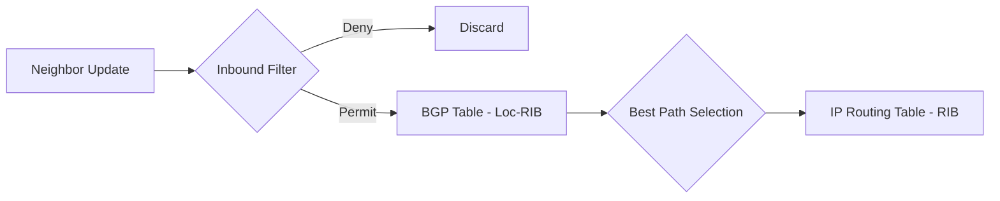

# Accepting Routes from Others

In the previous chapters, we focused on how to establish BGP sessions and how to tell the world about *our* networks. Now, we turn the tables: how do we safely and effectively receive routing information from the rest of the world?

When you connect to an ISP or a peer, they will send you BGP updates. Accepting these updates blindly is a recipe for disaster. In this chapter, we will learn how to build a **Routing Policy** to control exactly what enters our network.

---

## 1. Defining Routing Policy

A **Routing Policy** is a set of rules that determines how a router handles routing information. In BGP, policies are typically applied at the "edge" of your network—where you interface with other Autonomous Systems.

### The Inbound Pipeline
When a BGP update arrives from a neighbor, it doesn't immediately enter your BGP table (Loc-RIB). It passes through a series of filters first.



By applying a policy **inbound**, you control:
1.  **Memory Usage:** By rejecting prefixes you don't need.
2.  **Traffic Flow:** By modifying attributes (like Local Preference) to prefer one provider over another.
3.  **Security:** By rejecting invalid or malicious routes.

---

## 2. The Toolset: Prefix-Lists, AS-PATH Lists, and Route-Maps

To build a policy, we use three primary tools in FRR.

### Prefix-Lists
Prefix-lists match routes based on the **network address** and the **mask length**. They are much more efficient than standard Access Control Lists (ACLs) for routing.

*   **Logic:** `ip prefix-list NAME [permit|deny] PREFIX/LEN [ge MIN-MASK] [le MAX-MASK]`
*   **Example:** `ip prefix-list ONLY-SMALL-BLOCKS permit 0.0.0.0/0 ge 24 le 32` (Matches any prefix with a mask between /24 and /32).

### AS-PATH Access-Lists
These match routes based on the **AS_PATH** attribute using Regular Expressions (Regex).

*   **^** : Start of the path.
*   **$** : End of the path.
*   **_** : Any delimiter (space, comma, start/end).
*   **.*** : Anything.

**Common Regex Patterns:**
| Pattern | Meaning |
| :--- | :--- |
| `^$` | Routes originated by the local AS (Internal). |
| `^65001$` | Routes originated by AS 65001 and directly connected. |
| `_65001_` | Any route that has passed through AS 65001. |
| `^65001 .*` | Routes originated by AS 65001 or any of its customers. |

### Route-Maps
The "Swiss Army Knife" of routing. Route-maps use `match` statements to find routes and `set` statements to change their attributes.

```text
route-map MY-POLICY permit 10
 match ip address prefix-list MY-PREFIXES
 match as-path MY-AS-PATHS
 set local-preference 200
```

---

## 3. Hands-on Scenario 1: The "Default Route Only" Filter

Imagine you have a low-end router with limited memory. You only want a **Default Route** (0.0.0.0/0) from your ISP to reach the Internet. You don't want the 900,000+ prefixes of the full Internet table.

### Configuration

1.  **Define the Prefix-List:**
    ```text
    ip prefix-list PL-DEFAULT-ONLY permit 0.0.0.0/0
    ```

2.  **Create the Route-Map:**
    ```text
    route-map RM-DEFAULT-ONLY permit 10
     match ip address prefix-list PL-DEFAULT-ONLY
    ```

3.  **Apply to the Neighbor (Inbound):**
    ```text
    router bgp 65000
     address-family ipv4 unicast
      neighbor 10.0.13.3 route-map RM-DEFAULT-ONLY in
     exit-address-family
    ```

---

## 4. Hands-on Scenario 2: Filtering by Origin (AS-PATH Regex)

Sometimes you want to accept routes from a neighbor, but **only** the routes that they actually own (originate). You don't want to accept routes they learned from their other peers (which could turn you into an accidental transit provider!).

### The Task
Accept only routes where the AS_PATH consists of exactly one AS: **65001**.

### Configuration

1.  **Define the AS-PATH List:**
    ```text
    ip as-path access-list AS-OWNED-ONLY permit ^65001$
    ```

2.  **Create the Route-Map:**
    ```text
    route-map RM-OWNED-ONLY permit 10
     match as-path AS-OWNED-ONLY
    ```

3.  **Apply Inbound:**
    ```text
    router bgp 65000
     address-family ipv4 unicast
      neighbor 10.0.13.3 route-map RM-OWNED-ONLY in
     exit-address-family
    ```

---

## 5. Hands-on Scenario 3: Defensive Hygiene & Prefix Limits

### The "Bogon" Filter
"Bogons" are IP spaces that should never appear in the public BGP table (e.g., private ranges, reserved space). Accepting them can lead to routing loops or security holes.

```text
ip prefix-list PL-BOGONS deny 10.0.0.0/8 le 32
ip prefix-list PL-BOGONS deny 172.16.0.0/12 le 32
ip prefix-list PL-BOGONS deny 192.168.0.0/16 le 32
ip prefix-list PL-BOGONS permit 0.0.0.0/0 le 32
```

### Prefix Limits
What if your neighbor accidentally sends you 1,000,000 routes instead of the expected 10? To protect your router, you should set a **Maximum Prefix** limit.

```text
router bgp 65000
 neighbor 10.0.13.3 maximum-prefix 1000
```
If the neighbor sends more than 1,000 prefixes, the BGP session will immediately **shutdown** to protect your memory. It will remain in the `Idle (PfxCt)` state until you manually reset it.

---

## 6. Verification and "Soft Resets"

How do you know if your policy is working?

### The "Received" vs. "Accepted" distinction
*   **Received:** Every route the neighbor sent (requires `soft-reconfiguration inbound`).
*   **Accepted:** The routes that survived your filters and are in your BGP table.

**Commands:**
*   `show ip bgp neighbor 10.0.13.3 received-routes` (What they sent).
*   `show ip bgp neighbor 10.0.13.3 routes` (What you kept).

### Applying Policy Changes
If you change a route-map, BGP doesn't automatically re-process existing routes. You must trigger a "Soft Reset". Unlike a hard reset, this **does not drop the TCP session**.

```text
clear ip bgp 10.0.13.3 soft in
```
This tells the router: *"Ask the neighbor to re-send their updates so I can run them through my new filters."*
