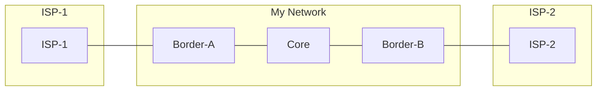

# Lab 3 - Multi-Homing, Policy, and Traffic Engineering

## Objectives
- Implement BGP in a dual-homed environment with two different ISPs.
- Originate prefixes with high availability using "Anchoring" on multiple border routers.
- Solve iBGP propagation issues in a non-full-mesh environment.
- Implement inbound filtering to control routing table size.
- Use **Local Preference** to steer outbound traffic toward a primary ISP.

## Topology & Addressing
This lab uses four routers: two in your AS (AS 65000) and two representing external ISPs.



| Device | Interface | IP Address | BGP Role |
| :--- | :--- | :--- | :--- |
| **R1** | eth1 (to ISP-1) | 10.0.1.1/24 | Border-A (AS 65000) |
| **R1** | eth2 (to R2) | 10.0.12.1/24 | Border-A (AS 65000) |
| **R2** | eth1 (to R1) | 10.0.12.2/24 | Core (AS 65000) |
| **R2** | eth2 (to R4) | 10.0.24.2/24 | Core (AS 65000) |
| **R4** | eth1 (to R2) | 10.0.24.4/24 | Border-B (AS 65000) |
| **R4** | eth2 (to ISP-2) | 10.0.2.4/24 | Border-B (AS 65000) |

---

## Deployment
Use the provided `lab-3.clab.yml` to start the topology:
```bash
sudo containerlab deploy -t lab-3.clab.yml
```

---

## Task 1: Basic Peering & Route Origination
Your task is to announce your network `192.0.2.0/24` to the world.

1.  **Anchoring:** On both R1 and R4, create a blackhole route for your network.
    ```text
    ip route 192.0.2.0/24 blackhole
    ```
2.  **BGP Config:** Enable BGP on R1 and R4, establish eBGP with your respective ISPs, and use the `network` command.
3.  **Verification:** Check ISP-1 and ISP-2. Do they see `192.0.2.0/24` in their BGP tables?

---

## Task 2: Internal Propagation (iBGP)
Now, establish iBGP sessions between **R1-R2** and **R4-R2**.

1.  **The Goal:** R2 should learn the full Internet (simulated) from both R1 and R4.
2.  **The Problem:** Look at the BGP table on R2 (`show ip bgp`). Why are the routes learned from the ISPs marked as "unreachable" or "invalid"?
3.  **The Fix:** Apply `next-hop-self` on R1 and R4 for their iBGP sessions toward R2.
    ```text
    ! Example on R1
    router bgp 65000
     address-family ipv4 unicast
      neighbor 10.0.12.2 next-hop-self
     exit-address-family
    ```

---

## Task 3: Inbound Filtering (The "Default Only" Policy)
ISP-1 is sending you many routes, but you only want a **Default Route** to save memory on R1.

1.  **Define Policy:** Create a prefix-list that only permits `0.0.0.0/0`.
2.  **Apply:** Use a route-map to apply this prefix-list **inbound** on R1's session with ISP-1.
3.  **Verification:** Run `show ip bgp` on R1. You should only see `0.0.0.0/0` from ISP-1.

---

## Task 4: Traffic Engineering (Local Preference)
Currently, R2 will pick a path based on its internal proximity. We want to force R2 to **always** use R1 (ISP-1) as the exit point for all Internet traffic.

1.  **Identify the Tool:** We will use **Local Preference**.
2.  **Configuration (R1):** Create a route-map that sets the local-pref to 200 and apply it inbound from ISP-1.
    ```text
    route-map RM-PRIMARY-ISP permit 10
     set local-preference 200
    !
    router bgp 65000
     address-family ipv4 unicast
      neighbor 10.0.1.100 route-map RM-PRIMARY-ISP in
    ```
3.  **Soft Reset:** Don't forget to run `clear ip bgp 10.0.1.100 soft in`.
4.  **Verification:**
    *   On R2, run `show ip bgp`. Is the path via R1 (10.0.12.1) now preferred (marked with `>`)?
    *   Perform a `traceroute` from R2 to an external IP. Does it exit via R1?

---

## Bonus: Failover Test
1.  Shut down the interface on R1 toward ISP-1.
2.  Watch how R2 automatically updates its BGP table to use the path via R4 (ISP-2).
3.  Bring the interface back up and watch the traffic return to R1 once the Local-Pref 200 routes are re-learned.
