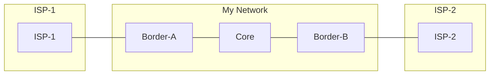

# Lab 3 - Multi-Homing, Policy, and Traffic Engineering

## Objectives
- Implement BGP in a dual-homed environment with two different ISPs.
- Write real inbound and outbound eBGP policies, and keep your network from becoming a transit path between your ISPs.
- Originate prefixes with high availability using "Anchoring" on multiple border routers.
- Solve iBGP propagation issues in a non-full-mesh environment.
- Implement inbound filtering to keep unwanted routes out of your network.
- Use **Local Preference** to steer outbound traffic toward a primary ISP.

## Topology & Addressing
This lab uses five routers: three in your AS (AS 65000) and two representing external ISPs. Inside your AS, OSPF is already running and advertises the loopbacks and the internal links. The ISPs are fully configured.



| Device    | Interface       | IP Address                    | Role                 |
| :-------- | :-------------- | :---------------------------- | :------------------- |
| **R1**    | lo              | 10.255.0.1/32                 | Border-A (AS 65000)  |
| **R1**    | eth1 (to ISP-1) | 10.0.1.1/24                   |                      |
| **R1**    | eth2 (to R2)    | 10.0.12.1/24                  |                      |
| **R2**    | lo              | 10.255.0.2/32, 192.0.2.2/32   | Core (AS 65000)      |
| **R2**    | eth1 (to R1)    | 10.0.12.2/24                  |                      |
| **R2**    | eth2 (to R4)    | 10.0.24.2/24                  |                      |
| **R4**    | lo              | 10.255.0.4/32                 | Border-B (AS 65000)  |
| **R4**    | eth1 (to R2)    | 10.0.24.4/24                  |                      |
| **R4**    | eth2 (to ISP-2) | 10.0.2.4/24                   |                      |
| **ISP-1** | eth1            | 10.0.1.100/24                 | AS 65001             |
| **ISP-2** | eth1            | 10.0.2.100/24                 | AS 65002             |

`192.0.2.2` on R2 plays the role of a server inside your network; we'll use it as the source of test traffic. Both ISPs send you a default route, their own prefix (`198.51.100.0/24` from ISP-1, `203.0.113.0/24` from ISP-2), and `198.18.0.0/24`, a remote network both of them can reach. Each ISP also sends a couple of routes you shouldn't accept.

---

## Deployment
Use the provided `lab-3.clab.yml` to start the topology:
```bash
cd labs/lab-3
sudo containerlab deploy
```

Check that OSPF is up before you start (`show ip ospf neighbor` on R2 should list R1 and R4).

---

## Task 1: Basic Peering, Route Origination and Export Policy
Your task is to announce your network `192.0.2.0/24` to the world, from both border routers.

1.  **Anchoring:** On both R1 and R4, create a blackhole route for your network.
    ```text
    ip route 192.0.2.0/24 blackhole
    ```
2.  **Policies:** This time we keep FRR's eBGP policy requirement (Lab 1) and write the policies it asks for. Outbound, announce **only** your own prefix. Inbound, accept everything for now; Task 3 tightens it. On R1:
    ```text
    ip prefix-list PL-MY-PREFIXES seq 5 permit 192.0.2.0/24
    !
    route-map RM-ISP1-OUT permit 10
     match ip address prefix-list PL-MY-PREFIXES
    exit
    !
    route-map RM-ISP1-IN permit 10
    exit
    ```
    A route-map entry without `match` statements matches every route.
3.  **BGP Config:** Enable BGP on R1, establish eBGP with ISP-1 and apply the policies:
    ```text
    router bgp 65000
     bgp router-id 10.255.0.1
     neighbor 10.0.1.100 remote-as 65001
     address-family ipv4 unicast
      network 192.0.2.0/24
      neighbor 10.0.1.100 route-map RM-ISP1-IN in
      neighbor 10.0.1.100 route-map RM-ISP1-OUT out
     exit-address-family
    ```
    Do the same on R4 towards ISP-2 (`10.0.2.100`, AS 65002), with route-maps named `RM-ISP2-IN` and `RM-ISP2-OUT`.
4.  **Verification:** Check ISP-1 and ISP-2. Do they see `192.0.2.0/24` in their BGP tables?
    ```text
    isp1# show ip bgp
    ...
     *>  192.0.2.0/24     10.0.1.1                 0             0 65000 i
    ```

---

## Task 2: Internal Propagation (iBGP)
Now, establish iBGP sessions over the loopbacks between **R1-R2** and **R4-R2** (OSPF already provides reachability between the loopbacks):

```text
! On R1 and R4
router bgp 65000
 neighbor 10.255.0.2 remote-as 65000
 neighbor 10.255.0.2 update-source lo
!
! On R2
router bgp 65000
 bgp router-id 10.255.0.2
 neighbor 10.255.0.1 remote-as 65000
 neighbor 10.255.0.1 update-source lo
 neighbor 10.255.0.4 remote-as 65000
 neighbor 10.255.0.4 update-source lo
```

1.  **The Goal:** R2 should learn the routes of both ISPs, from R1 and R4.
2.  **Problem 1:** Look at the BGP table on R2 (`show ip bgp`). Why are the routes learned from the ISPs not valid (no `*`)?
    ```text
    r2# show ip bgp
    ...
       i 0.0.0.0/0        10.0.1.100               0    100      0 65001 i
       i                  10.0.2.100               0    100      0 65002 i
    ```
3.  **Fix 1:** Apply `next-hop-self` on R1 and R4 for their iBGP sessions toward R2.
    ```text
    ! Example on R1
    router bgp 65000
     address-family ipv4 unicast
      neighbor 10.255.0.2 next-hop-self
     exit-address-family
    ```
4.  **Problem 2:** R2 now has valid routes from both ISPs. Now look at R4: it only knows ISP-2's routes, and R1 only knows ISP-1's. Why doesn't R2 pass them along? (Hint: the iBGP Split-Horizon rule.)
5.  **Fix 2:** Make R2 a **Route Reflector** with R1 and R4 as its clients:
    ```text
    router bgp 65000
     address-family ipv4 unicast
      neighbor 10.255.0.1 route-reflector-client
      neighbor 10.255.0.4 route-reflector-client
     exit-address-family
    ```
6.  **Verification:** R4 now learns ISP-1's prefix from R2, with the route reflection attributes:
    ```text
    r4# show ip bgp 198.51.100.0/24
    BGP routing table entry for 198.51.100.0/24, version 8
    Paths: (1 available, best #1, table default)
      Not advertised to any peer
      65001
        10.255.0.1 (metric 20) from 10.255.0.2 (10.255.0.1)
          Origin IGP, metric 0, localpref 100, valid, internal, best (First path received)
          Originator: 10.255.0.1, Cluster list: 10.255.0.2
    ```

**Question:** R4 now has ISP-1's routes, but "Not advertised to any peer" says it doesn't pass them on to ISP-2. What would happen without the `RM-ISP2-OUT` export policy? Check ISP-2's table: it should only contain `192.0.2.0/24` from you.

---

## Task 3: Inbound Filtering (Defensive Hygiene)
The ISPs send you routes that shouldn't be in your table: private address space ("bogons") and prefixes longer than /24, which most networks don't accept. Your own prefix should never come back to you from outside either.

1.  **See what you receive:** Enable `soft-reconfiguration inbound` towards the ISP, so that you can see the routes before your policy is applied:
    ```text
    router bgp 65000
     address-family ipv4 unicast
      neighbor 10.0.1.100 soft-reconfiguration inbound
    ```
2.  **Define Policy:** Create a prefix-list that denies bogons and your own prefix, and permits the default route and any prefix from /8 to /24:
    ```text
    ip prefix-list PL-ISP-IN seq 5 deny 0.0.0.0/8 le 32
    ip prefix-list PL-ISP-IN seq 10 deny 10.0.0.0/8 le 32
    ip prefix-list PL-ISP-IN seq 15 deny 100.64.0.0/10 le 32
    ip prefix-list PL-ISP-IN seq 20 deny 127.0.0.0/8 le 32
    ip prefix-list PL-ISP-IN seq 25 deny 169.254.0.0/16 le 32
    ip prefix-list PL-ISP-IN seq 30 deny 172.16.0.0/12 le 32
    ip prefix-list PL-ISP-IN seq 35 deny 192.168.0.0/16 le 32
    ip prefix-list PL-ISP-IN seq 40 deny 224.0.0.0/3 le 32
    ip prefix-list PL-ISP-IN seq 45 deny 192.0.2.0/24 le 32
    ip prefix-list PL-ISP-IN seq 100 permit 0.0.0.0/0
    ip prefix-list PL-ISP-IN seq 105 permit 0.0.0.0/0 ge 8 le 24
    ```
    A complete bogon list would also deny the documentation and benchmarking ranges, which this course uses as if they were public addresses.
3.  **Apply:** Match the prefix-list in the inbound route-map, and add a prefix limit:
    ```text
    route-map RM-ISP1-IN permit 10
     match ip address prefix-list PL-ISP-IN
    !
    router bgp 65000
     neighbor 10.0.1.100 maximum-prefix 100
    ```
    Do the same on R4 for ISP-2.
4.  **Verification:** Compare what ISP-1 sends with what you keep:
    ```text
    r1# show ip bgp neighbors 10.0.1.100 received-routes
    ...
     *> 0.0.0.0/0        10.0.1.100               0             0 65001 i
     *> 10.99.0.0/16     10.0.1.100               0             0 65001 i
     *> 192.0.2.0/24     10.0.1.100                             0 65001 65000 i
     *> 198.18.0.0/24    10.0.1.100               0             0 65001 i
     *> 198.51.100.0/24  10.0.1.100               0             0 65001 i
     *> 198.51.100.128/25
                        10.0.1.100               0             0 65001 i

    Total number of prefixes 6 (3 filtered)

    r1# show ip bgp neighbors 10.0.1.100 routes
    ...
     *>  0.0.0.0/0        10.0.1.100               0             0 65001 i
     *>  198.18.0.0/24    10.0.1.100               0             0 65001 i
     *>  198.51.100.0/24  10.0.1.100               0             0 65001 i
    ```

---

## Task 4: Traffic Engineering (Local Preference)
Both ISPs can reach `198.18.0.0/24`, and both send you a default route. Look at the paths to `198.18.0.0/24` before changing anything:

- **R4** prefers its own eBGP path via ISP-2 over the iBGP path via R1 ("prefer eBGP over iBGP").
- **R2** has two iBGP paths that tie on every attribute. Which one wins, and which step of the Best Path Selection algorithm decides it?

We want the whole AS to **always** use ISP-1 as the exit point, as long as it is available.

1.  **Identify the Tool:** We will use **Local Preference**, which travels with the route to every router in the AS.
2.  **Configuration (R1):** Set the local-pref to 200 in the inbound route-map from ISP-1:
    ```text
    route-map RM-ISP1-IN permit 10
     set local-preference 200
    ```
    FRR applies the change by itself after a few seconds. On other platforms, you would now run `clear ip bgp 10.0.1.100 soft in`.
3.  **Verification:**
    *   On R4, run `show ip bgp`. The path via R1 (`10.255.0.1`, LocPrf 200) is now preferred over R4's own eBGP path:
        ```text
        r4# show ip bgp
        ...
         *>i 0.0.0.0/0        10.255.0.1               0    200      0 65001 i
         *                    10.0.2.100               0             0 65002 i
         ...
         *>i 198.18.0.0/24    10.255.0.1               0    200      0 65001 i
         *                    10.0.2.100               0             0 65002 i
        ```
    *   Run a `traceroute` from R2's server address to the remote network. Does it exit via R1?
        ```text
        $ docker exec clab-bgp101-lab3-r2 traceroute -n -s 192.0.2.2 198.18.0.1
        traceroute to 198.18.0.1 (198.18.0.1) from 192.0.2.2, 30 hops max, 46 byte packets
         1  10.0.12.1  0.003 ms  0.001 ms  0.002 ms
         2  198.18.0.1  0.002 ms  0.001 ms  0.002 ms
        ```

**Question:** Why do we source the traceroute from `192.0.2.2` instead of R2's loopback, `10.255.0.2`?

---

## Bonus: Failover Test
1.  Shut down the interface on R1 toward ISP-1 (`interface eth1`, `shutdown`).
2.  Watch how R2 and R4 update their BGP tables to use the path via R4 (ISP-2), and repeat the traceroute: the first hop is now `10.0.24.4`.
3.  Bring the interface back up (`no shutdown`) and watch the traffic return to R1 once the Local-Pref 200 routes are re-learned.

The finished configurations of R1, R2 and R4 are in `labs/lab-3/solution/`.
