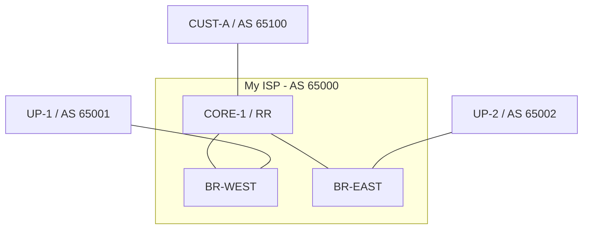

# Lab 4 - Capstone: The Regional Service Provider

## Objectives
- Build a scalable ISP core using **OSPF** and **iBGP Route Reflection**.
- Implement secure customer onboarding with prefix filtering and limits.
- Manage multi-provider transit using **Local Preference** and **AS-PATH Prepending**.
- Implement **Remote Triggered Blackholing (RTBH)** for your customers using **BGP Communities**.

## Topology
You are operating **AS 65000**. Your network consists of a central core router and two border routers. This time the routers of AS 65000 only have their interfaces addressed: everything else is up to you. The upstreams and the customer are configured.



| Device      | Interface         | IP Address                       | Role                |
| :---------- | :---------------- | :------------------------------- | :------------------ |
| **CORE-1**  | lo                | 10.255.0.1/32                    | Core, RR (AS 65000) |
| **CORE-1**  | eth1 (to BR-WEST) | 10.0.12.1/24                     |                     |
| **CORE-1**  | eth2 (to BR-EAST) | 10.0.13.1/24                     |                     |
| **CORE-1**  | eth3 (to CUST-A)  | 10.0.100.1/30                    |                     |
| **BR-WEST** | lo                | 10.255.0.2/32                    | Border (AS 65000)   |
| **BR-WEST** | eth1 (to CORE-1)  | 10.0.12.2/24                     |                     |
| **BR-WEST** | eth2 (to UP-1)    | 10.0.1.2/24                      |                     |
| **BR-EAST** | lo                | 10.255.0.3/32                    | Border (AS 65000)   |
| **BR-EAST** | eth1 (to CORE-1)  | 10.0.13.3/24                     |                     |
| **BR-EAST** | eth2 (to UP-2)    | 10.0.2.3/24                      |                     |
| **UP-1**    | eth1              | 10.0.1.100/24                    | Upstream (AS 65001) |
| **UP-2**    | eth1              | 10.0.2.100/24                    | Upstream (AS 65002) |
| **CUST-A**  | eth1              | 10.0.100.2/30                    | Customer (AS 65100) |
| **CUST-A**  | lo                | 203.0.113.1/32, 203.0.113.50/32  |                     |

- Your address block is `192.0.2.0/24`.
- Both upstreams send a default route and `198.18.0.0/24`, a remote network with a test address, `198.18.0.1`.
- CUST-A has been assigned `203.0.113.0/24`.

---

## Deployment
Use the provided `lab-4.clab.yml` to start the topology:
```bash
cd labs/lab-4
sudo containerlab deploy
```

---

## Task 1: The Foundation (IGP & iBGP)
Before BGP can work, your internal routers must be able to reach each other's Loopbacks.

1.  **OSPF:** Enable OSPF area 0 on the internal links and loopbacks of AS 65000. In FRR, you can enable it per interface (`ip ospf area 0`); remember to set a router ID under `router ospf`. Also enable it on CORE-1's link to CUST-A as a **passive** interface: the border routers will need to reach CUST-A's address, which is the next hop of CUST-A's routes.
2.  **iBGP Route Reflection:**
    *   Configure CORE-1 as a **Route Reflector**.
    *   BR-WEST and BR-EAST should be neighbors of CORE-1 (using loopbacks).
    *   On CORE-1, set the border routers as `route-reflector-client`.
3.  **Verification:** `show ip ospf neighbor` on CORE-1 lists both border routers, and `show bgp summary` shows both iBGP sessions established.

---

## Task 2: Customer Onboarding (AS 65100)
CUST-A is a new customer. You have assigned them the block `203.0.113.0/24`. Remember that FRR requires inbound and outbound policies on every eBGP session (Lab 3).

1.  **Strict Filtering:** Create a prefix-list on CORE-1 that *only* allows `203.0.113.0/24` from CUST-A, and apply it inbound with a route-map.
2.  **Outbound:** Send CUST-A all your routes (a route-map that permits everything).
3.  **Prefix Limit:** Implement `maximum-prefix 5` on the neighbor session to prevent them from sending too many routes.
4.  **Verification:**
    *   On CUST-A, `show ip bgp neighbors 10.0.100.1 advertised-routes` shows what the customer sends. Is there anything that shouldn't be there? Does it make it past your filter (`show ip bgp neighbors 10.0.100.2 routes` on CORE-1)?
    *   Ensure CORE-1 sees `203.0.113.0/24` and reflects it to the border routers.

---

## Task 3: Multi-Provider Transit (TE)
You have two upstreams. UP-1 (AS 65001) is your primary provider.

1.  **Origination and Export:** Announce `192.0.2.0/24` from both border routers (anchored, as in Lab 3). Towards the upstreams, announce **only** your block and your customer's: `192.0.2.0/24` and `203.0.113.0/24`. Use `next-hop-self` towards CORE-1.
2.  **Outbound TE (Local-Pref):** On BR-WEST, set a **Local Preference of 200** for all routes received from UP-1.
3.  **Inbound TE (AS-Path Prepending):** On BR-EAST, make your network look less attractive to the world. Prepend your ASN three times (`65000 65000 65000`) for all outbound advertisements to UP-2.
4.  **Verification:**
    *   Check CORE-1: Does it prefer the path through BR-WEST (`10.255.0.2`, LocPrf 200) for external routes?
    *   Check UP-2: Does it see your prefixes with a long AS_PATH?
        ```text
        up2# show ip bgp
        ...
         *>  192.0.2.0/24     10.0.2.3                 0             0 65000 65000 65000 65000 i
         *>  203.0.113.0/24   10.0.2.3                               0 65000 65000 65000 65000 65100 i
        ```
    *   From CUST-A, `traceroute -n -s 203.0.113.1 198.18.0.1` should go through CORE-1 and BR-WEST.

---

## Task 4: Advanced Policy (RTBH with BGP Communities)
CUST-A wants a way to "Blackhole" specific IPs during a DDoS attack: they announce the attacked address as a /32 tagged with the community `65000:666`, and your network drops all traffic to it at the border, before it reaches the customer's link.

The classic way to implement this ([RFC 5635](https://datatracker.ietf.org/doc/html/rfc5635)) uses a **discard next hop**: an address that every router in your AS routes to a blackhole. Routes whose next hop is the discard address are blackholed wherever they are installed.

1.  **Discard Route:** On CORE-1, BR-WEST and BR-EAST, route the discard address `192.0.2.1` to a blackhole:
    ```text
    ip route 192.0.2.1/32 blackhole
    ```
2.  **Define the Policy (CORE-1):** Add an entry in front of CUST-A's inbound route-map. It accepts /32s inside the customer's block **only** when they carry `65000:666`, sets their next hop to the discard address, and adds `no-export` so they never leave your AS:
    ```text
    ip prefix-list PL-CUST-A-RTBH seq 5 permit 203.0.113.0/24 ge 32
    bgp community-list standard CL-RTBH seq 5 permit 65000:666
    !
    route-map RM-CUST-A-IN permit 10
     match ip address prefix-list PL-CUST-A-RTBH
     match community CL-RTBH
     set ip next-hop 192.0.2.1
     set community no-export additive
    exit
    ```
    Your strict filter from Task 2 becomes the next entry of the same route-map (e.g., `permit 20`).
3.  **Trigger (CUST-A):** First check that the server answers: `docker exec clab-bgp101-lab4-up1 ping -c 2 -I 198.18.0.1 203.0.113.50`. Then, on CUST-A, announce `203.0.113.50/32` with the community `65000:666`:
    ```text
    ip prefix-list PL-RTBH seq 5 permit 203.0.113.50/32
    !
    route-map RM-TO-AS65000 permit 10
     match ip address prefix-list PL-RTBH
     set community 65000:666
    exit
    !
    route-map RM-TO-AS65000 permit 20
    exit
    !
    router bgp 65100
     address-family ipv4 unicast
      network 203.0.113.50/32
      neighbor 10.0.100.1 route-map RM-TO-AS65000 out
    ```
4.  **Verification:** Check the routing table on BR-WEST. Traffic for `203.0.113.50` is now discarded:
    ```text
    br-west# show ip route 203.0.113.50
    Routing entry for 203.0.113.50/32
      Known via "bgp", distance 200, metric 0, best
      ...
        192.0.2.1 (recursive), weight 1
      *   unreachable (blackhole), weight 1
    ```
    The ping from UP-1 to `203.0.113.50` now fails, while `203.0.113.1` still answers. Check that neither upstream received the /32.

---

## Final Verification Checklist
- [ ] CORE-1 has iBGP sessions up with both Border routers.
- [ ] OSPF is providing reachability between loopbacks.
- [ ] CORE-1 only accepts CUST-A's assigned block (and tagged /32s inside it).
- [ ] CUST-A can reach the simulated internet (`198.18.0.1`).
- [ ] Outbound traffic from the ISP prefers UP-1.
- [ ] UP-2 sees your prefixes with a prepended AS_PATH, and neither upstream sees anything but `192.0.2.0/24` and `203.0.113.0/24`.
- [ ] The Blackhole community correctly drops traffic for the targeted IP at the border.

The finished configurations are in `labs/lab-4/solution/`, including the change on CUST-A.
