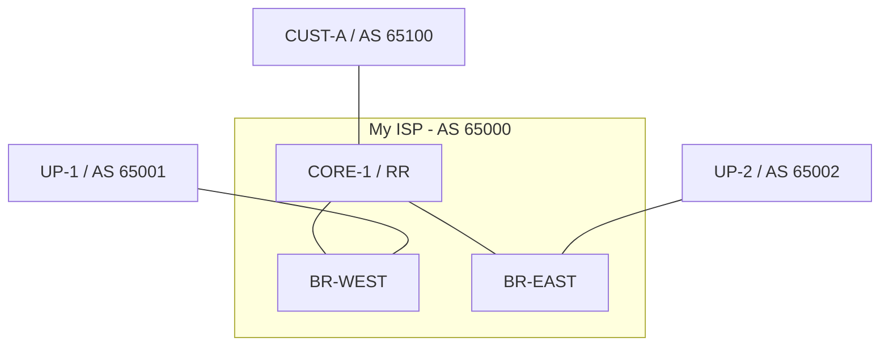

# Lab 4 - Capstone: The Regional Service Provider

## Objectives
- Build a scalable ISP core using **OSPF** and **iBGP Route Reflection**.
- Implement secure customer onboarding with prefix filtering and limits.
- Manage multi-provider transit using **Local Preference** and **AS-PATH Prepending**.
- Implement advanced Traffic Engineering using **BGP Communities** for Remote Triggered Blackholing (RTBH).

## Topology
You are operating **AS 65000**. Your network consists of a central core router and two border routers.



---

## Deployment
Use the provided `lab-4.clab.yml` to start the topology:
```bash
sudo containerlab deploy -t lab-4.clab.yml
```

---

## Task 1: The Foundation (IGP & iBGP)
Before BGP can work, your internal routers must be able to reach each other's Loopbacks.

1.  **Loopbacks:** Assign IP addresses to `lo` on CORE-1 (1.1.1.1/32), BR-WEST (2.2.2.2/32), and BR-EAST (3.3.3.3/32).
2.  **OSPF:** Enable OSPF on all internal links and loopbacks within AS 65000.
3.  **iBGP Route Reflection:**
    *   Configure CORE-1 as a **Route Reflector**.
    *   BR-WEST and BR-EAST should be neighbors of CORE-1 (using loopbacks).
    *   On CORE-1, set the border routers as `route-reflector-client`.

---

## Task 2: Customer Onboarding (AS 65100)
CUST-A is a new customer. You have assigned them the block `203.0.113.0/24`.

1.  **Strict Filtering:** Create a prefix-list on CORE-1 that *only* allows `203.0.113.0/24` from CUST-A.
2.  **Prefix Limit:** Implement `maximum-prefix 5` on the neighbor session to prevent them from sending too many routes.
3.  **Verification:** Ensure CORE-1 sees the route and reflects it to the border routers.

---

## Task 3: Multi-Provider Transit (TE)
You have two upstreams. UP-1 (AS 65001) is your primary provider.

1.  **Outbound TE (Local-Pref):** On BR-WEST, set a **Local Preference of 200** for all routes received from UP-1.
2.  **Inbound TE (AS-Path Prepending):** On BR-EAST, make your network look less attractive to the world. Prepend your ASN three times (`65000 65000 65000`) for all outbound advertisements to UP-2.
3.  **Verification:**
    *   Check CORE-1: Does it prefer the path through BR-WEST for external routes?
    *   Check UP-2: Does it see your prefixes with a long AS_PATH?

---

## Task 4: Advanced Policy (BGP Communities)
CUST-A wants a way to "Blackhole" specific IPs during a DDoS attack.

1.  **Define the Community:** Create a policy where if a route is received with the community `65000:666`, the next-hop is set to `blackhole`.
2.  **Implementation:** Apply this policy on CORE-1 for the CUST-A session.
3.  **Trigger:** On CUST-A, announce `203.0.113.50/32` with the community `65000:666`.
4.  **Verification:** Check the routing table on BR-WEST. Traffic for `203.0.113.50` should now be discarded.

---

## Final Verification Checklist
- [ ] CORE-1 has iBGP sessions up with both Border routers.
- [ ] OSPF is providing reachability between loopbacks.
- [ ] CUST-A can reach the simulated internet (UP-1/UP-2).
- [ ] Outbound traffic from the ISP prefers UP-1.
- [ ] The Blackhole community correctly drops traffic for the targeted IP.
