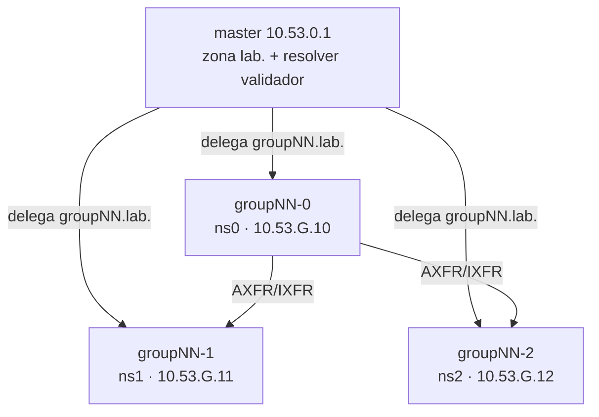

# 08 - Guía del laboratorio

Esta guía acompaña al laboratorio del curso: un entorno en containers donde cada grupo tiene tres servidores con BIND para hacer, de verdad, los ejercicios de los módulos [3](03-Zonas-BIND.md), [4](04-Firmando-con-BIND-y-KASP.md) y [6](06-Arquitectura-Hidden-Signer.md). Primero explica cómo entrar y usar el laboratorio; después recorre cada módulo con los nombres y direcciones de tu grupo, y señala dónde el laboratorio difiere del texto del módulo.

## Tu grupo, tus nombres y tus direcciones

En toda la guía, **`NN`** es tu número de grupo con dos dígitos (`01`, `02` …) y **`G`** es el mismo número sin el cero a la izquierda (`1`, `2` …). Los nombres usan `NN`; las direcciones IP usan `G`. Por ejemplo, el grupo 3 tiene la zona `group03.lab.` y su primer nodo es `10.53.3.10`.

| Nodo | Nombre | IPv4 | IPv6 |
| --- | --- | --- | --- |
| `groupNN-0` | `ns0.groupNN.lab.` | `10.53.G.10` | `fd53::G:10` |
| `groupNN-1` | `ns1.groupNN.lab.` | `10.53.G.11` | `fd53::G:11` |
| `groupNN-2` | `ns2.groupNN.lab.` | `10.53.G.12` | `fd53::G:12` |

En los módulos 3 y 4, `groupNN-0` es el primario (y después el que firma) y los otros dos son secundarios. En el módulo 6, `groupNN-0` pasa a ser el hidden signer y los otros dos quedan como los servidores públicos.

Además, todos los grupos comparten el **master** del laboratorio, `10.53.0.1` (`fd53::1`), que cumple tres funciones:

- **Zona padre**: es autoritativo para `lab.`, un TLD que solo existe en el laboratorio, firmado con DNSSEC. `lab.` ya delega `groupNN.lab.` a tus tres nodos (`ns0`, `ns1` y `ns2.groupNN.lab.`), con los registros glue A y AAAA.
- **Resolver validador**: tus nodos lo usan como resolver (`/etc/resolv.conf`). Valida DNSSEC con la clave de `lab.` como ancla de confianza, así que un `dig` sin `@` te muestra el flag `ad` cuando la cadena de confianza está completa.
- **Salida a internet**: tus nodos llegan a internet (por ejemplo, para `apt`) solo a través de él, por IPv4.



Todos los nodos de todos los grupos están en la misma red (`10.53.0.0/16`, `fd53::/64`): puedes consultar los servidores de otros grupos, y ellos los tuyos.

## Entrar al laboratorio

### Lo que te da el instructor

- La **dirección** de la página del laboratorio, por ejemplo `https://lab.ejemplo.org/`.
- Tu **usuario** (`groupNN`) y tu **contraseña**, uno por grupo.
- La **huella SHA-256** del certificado de la página (ver más abajo).

### La advertencia del certificado

Por ahora la página usa un certificado autofirmado, así que el navegador muestra una advertencia la primera vez ("La conexión no es privada", "Advertencia: riesgo potencial de seguridad"). Antes de aceptarla, comprueba que el certificado es el del laboratorio:

1. En la advertencia, abre los detalles del certificado (en Chrome: clic en "No seguro" o en el texto del error, luego "El certificado no es válido"; en Firefox: "Avanzado", luego "Ver certificado").
2. Busca la huella **SHA-256** y compárala con la que te dio el instructor. Tienen que coincidir carácter por carácter.
3. Si coinciden, continúa ("Avanzado" → "Continuar al sitio" en Chrome, "Aceptar el riesgo y continuar" en Firefox). Si no coinciden, no ingreses tu contraseña y avisa al instructor.

Es la misma lógica que DNSSEC, a otra escala: confías en una clave porque la comparaste con un dato que obtuviste por un canal en el que ya confías.

### La página

Ingresa con tu usuario y contraseña. La sesión dura 12 horas; **Salir** la cierra.

- La tabla muestra tus tres nodos: **Nodo**, **Estado**, **IPv4**, **IPv6** y **Activo hace**. Se actualiza sola cada dos segundos.
- **Iniciar**, **Detener** y **Reiniciar** actúan sobre el container completo, como encender, apagar o reiniciar el servidor. Sirven para recuperar un nodo que quedó mal. Para que BIND tome un cambio de configuración no hacen falta: usa `rndc reload` o `systemctl restart bind9` dentro del nodo.
- **Clic en el nombre de un nodo** abre una terminal en una pestaña nueva: una shell de `root` en ese nodo. Puedes abrir varias a la vez, una por nodo.
- **DS en `lab.`** es el panel de "registrador" de tu zona: muestra los DS que `lab.` publica para `groupNN.lab.`, y permite publicar y quitar DS. Lo usas en el módulo 4.

Dos cosas a tener en cuenta con las terminales:

- **Cerrar la pestaña termina la shell** y todo lo que estaba corriendo en ella. Si dejas algo largo corriendo (un `tcpdump`, un `journalctl -f`), deja la pestaña abierta.
- Para copiar, selecciona el texto con el mouse; para copiar y pegar usa el menú contextual del navegador (clic derecho) o, en macOS, `Cmd+C` y `Cmd+V`. `Ctrl+C` en la terminal interrumpe el comando, como siempre.

## Antes de empezar: qué cambia respecto del libro

Los nodos son Ubuntu 24.04 con BIND 9.18 y systemd, igual que los servidores del libro, así que `systemctl`, `journalctl -u named`, `rndc` y las rutas de `/etc/bind` funcionan como en el texto. Lo que cambia:

| En el libro | En el laboratorio |
| --- | --- |
| `example.com` | `groupNN.lab.` |
| `192.0.2.1`, `.2`, `.3` | `10.53.G.10`, `.11`, `.12` (tus tres nodos) |
| `ns1`, `ns2`, `ns3.example.com` | `ns0`, `ns1`, `ns2.groupNN.lab.` (ya delegados en `lab.`) |
| `sudo …` | No hace falta: en la terminal ya eres `root`. |
| Instalar BIND (`apt install bind9 …`) | Ya está instalado y corriendo, con la configuración de Ubuntu sin tocar. `rndc` ya funciona en cada nodo. |
| Archivo de zona en `/etc/bind/db.example.com` | En `/var/lib/bind/db.groupNN.lab`. Con firma inline (módulo 4), `named` escribe archivos junto al de la zona (`.signed`, `.jnl`), y no puede escribir en `/etc/bind`: falla con `permission denied`. `/var/lib/bind` es el directorio que Ubuntu prevé para eso. |
| AppArmor | No está activo dentro de los containers; los errores de AppArmor del módulo 3 no aparecen. |
| Delegación y glue en el padre | Ya están hechos para `ns0`, `ns1` y `ns2`. El DS lo publicas tú en el panel **DS en `lab.`**. |
| `rndc signing -list` | `rndc dnssec -status groupNN.lab` (con `dnssec-policy`, BIND rechaza `signing -list`). |
| `dnssec-verify … example.com.signed` | `rndc sync` primero y `-I raw` (ver el módulo 4, más abajo). |
| `delv @127.0.0.1 …` | `delv-lab @10.53.0.1 …` (ver "Verificar la cadena de confianza"). |
| `allow-query { none; }` produce un timeout | Produce `status: REFUSED`. Un timeout requeriría además un firewall. |

Si `apt install` responde `Unable to locate package`, corre `apt update` primero.

## Módulo 3 en el laboratorio: primario y secundarios

Objetivo: `groupNN-0` es el primario de `groupNN.lab.`; `groupNN-1` y `groupNN-2` son secundarios, con transferencias autenticadas con TSIG y NOTIFY. Al final, el resolver del master resuelve tu zona a través de la delegación de `lab.`.

### 1. Opciones de seguridad en los tres nodos

En **cada uno** de los tres nodos, edita `/etc/bind/named.conf.options` (con `vim` o `nano`) y agrega dentro del bloque `options { … };` lo que el módulo 3 explica en "Consideraciones de seguridad":

```
options {
	directory "/var/cache/bind";
	dnssec-validation auto;
	listen-on-v6 { any; };

	recursion no;
	allow-recursion { none; };
	allow-transfer { none; };
};
```

Valida y recarga: `named-checkconf && rndc reload`.

### 2. La zona primaria en `groupNN-0`

Crea `/var/lib/bind/db.groupNN.lab`:

```zone
$TTL 3600
groupNN.lab.        IN  SOA   ns0.groupNN.lab. admin.groupNN.lab. (
                                     2026112701 ; serial
                                     3600       ; refresh
                                     600        ; retry
                                     1209600    ; expire
                                     3600 )     ; minimum
groupNN.lab.        IN  NS    ns0.groupNN.lab.
groupNN.lab.        IN  NS    ns1.groupNN.lab.
groupNN.lab.        IN  NS    ns2.groupNN.lab.
ns0.groupNN.lab.    IN  A     10.53.G.10
ns0.groupNN.lab.    IN  AAAA  fd53::G:10
ns1.groupNN.lab.    IN  A     10.53.G.11
ns1.groupNN.lab.    IN  AAAA  fd53::G:11
ns2.groupNN.lab.    IN  A     10.53.G.12
ns2.groupNN.lab.    IN  AAAA  fd53::G:12
www.groupNN.lab.    IN  A     10.53.G.10
```

Los tres NS y sus direcciones coinciden con la delegación y el glue que `lab.` ya publica: es la "coherencia de delegación" del final del módulo 3.

`named` necesita poder escribir junto a este archivo más adelante, así que dale el archivo al usuario `bind`:

```
# chown bind:bind /var/lib/bind/db.groupNN.lab
# named-checkzone groupNN.lab /var/lib/bind/db.groupNN.lab
```

### 3. La clave TSIG, en los tres nodos

En `groupNN-0`, genera la clave en un archivo propio:

```
# tsig-keygen transfer-key > /etc/bind/transfer-key.key
# chown root:bind /etc/bind/transfer-key.key
# chmod 640 /etc/bind/transfer-key.key
# cat /etc/bind/transfer-key.key
```

Copia la salida del `cat` y crea el mismo archivo en `groupNN-1` y `groupNN-2`, pegando el contenido:

```
# cat > /etc/bind/transfer-key.key <<'EOF'
key "transfer-key" {
	algorithm hmac-sha256;
	secret "…el mismo secreto…";
};
EOF
# chown root:bind /etc/bind/transfer-key.key
# chmod 640 /etc/bind/transfer-key.key
```

En los tres nodos, inclúyela al principio de `/etc/bind/named.conf.local`:

```
include "/etc/bind/transfer-key.key";
```

### 4. Declarar la zona en el primario

En `groupNN-0`, agrega a `/etc/bind/named.conf.local`:

```
zone "groupNN.lab" {
    type primary;
    file "/var/lib/bind/db.groupNN.lab";
    allow-transfer { key transfer-key; };
    also-notify { 10.53.G.11; 10.53.G.12; };
    notify yes;
};
```

Valida, recarga y confirma:

```
# named-checkconf
# rndc reload
# journalctl -u named --since "1 min ago" | grep groupNN
# dig @127.0.0.1 groupNN.lab SOA +short
# dig @127.0.0.1 www.groupNN.lab A +short
```

### 5. Los secundarios

En `groupNN-1` y en `groupNN-2`, agrega a `/etc/bind/named.conf.local`:

```
zone "groupNN.lab" {
    type secondary;
    primaries { 10.53.G.10 key transfer-key; };
    file "/var/cache/bind/groupNN.lab.secondary";
};
```

Recarga y comprueba que transfirieron la zona:

```
# named-checkconf && rndc reload
# journalctl -u named --since "1 min ago" | grep -i transfer
# dig @127.0.0.1 groupNN.lab SOA +short
```

El serial tiene que ser el mismo que en el primario. El archivo `/var/cache/bind/groupNN.lab.secondary` está en formato binario (`raw`), el formato por defecto de BIND para las zonas secundarias; para verla en texto usa `dig … AXFR`, como en el paso siguiente.

### 6. Probar NOTIFY, AXFR y TSIG

- **NOTIFY**: en `groupNN-0`, agrega un registro (por ejemplo `mail.groupNN.lab. IN A 10.53.G.10`), sube el serial y recarga con `rndc reload groupNN.lab`. En pocos segundos los secundarios tienen el serial nuevo. En el log de un secundario (`journalctl -u named -f`) vas a ver el NOTIFY y la transferencia, normalmente IXFR.
- **AXFR sin clave**: desde cualquier nodo, `dig @10.53.G.10 groupNN.lab AXFR` termina en `Transfer failed.`: el primario solo transfiere a quien presenta la clave. Prueba también contra el primario de otro grupo.
- **AXFR con clave**: `dig -k /etc/bind/transfer-key.key @10.53.G.10 groupNN.lab AXFR` muestra la zona completa, del SOA al SOA.

### 7. Tu zona, vista desde afuera

Hasta ahora consultaste cada servidor directamente. Ahora, el camino que sigue un resolver:

```
# dig +norec @10.53.0.1 groupNN.lab NS
# dig www.groupNN.lab A
```

La primera consulta, sin recursión, le pregunta a `lab.`: la respuesta es una **referencia** (sección AUTHORITY con tus tres NS, sección ADDITIONAL con el glue). La segunda va al resolver del master, que sigue esa delegación hasta tus servidores. La respuesta llega sin el flag `ad`: la zona todavía no está firmada.

## Módulo 4 en el laboratorio: firmar la zona y publicar el DS

Objetivo: `groupNN-0` firma `groupNN.lab.` con KASP (firma inline), los secundarios sirven la zona firmada sin cambios, y publicas el DS en `lab.` desde la página. Al final, la cadena de confianza está completa desde `lab.`.

### 1. Directorio de claves y política

En `groupNN-0`:

```
# mkdir -p /etc/bind/keys/groupNN.lab
# chown bind:bind /etc/bind/keys/groupNN.lab
```

Agrega la `dnssec-policy` del módulo 4 al final de `/etc/bind/named.conf.options`, **fuera** del bloque `options { … };`:

```
dnssec-policy "operadores" {
    keys {
        ksk lifetime unlimited algorithm ecdsap256sha256;
        zsk lifetime P90D algorithm ecdsap256sha256;
    };

    dnskey-ttl PT1H;
    publish-safety PT1H;
    retire-safety PT1H;
    signatures-refresh P5D;
    signatures-validity P2W;
    signatures-validity-dnskey P2W;
    max-zone-ttl P1D;
    purge-keys P90D;
};
```

### 2. Activar la firma inline

En `/etc/bind/named.conf.local` de `groupNN-0`, agrega tres líneas a la zona:

```
zone "groupNN.lab" {
    type primary;
    file "/var/lib/bind/db.groupNN.lab";
    key-directory "/etc/bind/keys/groupNN.lab";
    dnssec-policy "operadores";
    inline-signing yes;

    allow-transfer { key transfer-key; };
    also-notify { 10.53.G.11; 10.53.G.12; };
    notify yes;
};
```

```
# named-checkconf
# rndc reload groupNN.lab
# journalctl -u named --since "1 min ago" | grep groupNN
# ls /etc/bind/keys/groupNN.lab/ /var/lib/bind/
# rndc dnssec -status groupNN.lab
```

En el directorio de claves vas a ver dos claves, cada una con sus archivos `.key`, `.private` y `.state` (el estado de KASP del que habla el módulo 6). En `/var/lib/bind/`, junto a tu archivo de zona, aparecen `db.groupNN.lab.signed` y los journals: esos son los archivos que `named` no habría podido crear en `/etc/bind`.

### 3. Verificar la firma

```
# dig @127.0.0.1 groupNN.lab DNSKEY +dnssec +multiline
# dig @127.0.0.1 www.groupNN.lab A +dnssec
# dig @10.53.G.11 www.groupNN.lab A +dnssec
```

La tercera consulta va a un secundario: sirve la zona firmada sin que hayas tocado su configuración.

`dnssec-verify` revisa el archivo firmado. Antes, `rndc sync` vuelca los cambios pendientes del journal al archivo, que además está en formato binario (`-I raw`):

```
# rndc sync groupNN.lab
# dnssec-verify -I raw -o groupNN.lab /var/lib/bind/db.groupNN.lab.signed
...
Zone fully signed:
Algorithm: ECDSAP256SHA256: KSKs: 1 active, 0 stand-by, 0 revoked
                            ZSKs: 1 active, 0 stand-by, 0 revoked
```

Y `delv`, con la variante del laboratorio:

```
# delv-lab @10.53.0.1 www.groupNN.lab A
```

Todavía no da `fully validated`: la zona está firmada y es consistente, pero `lab.` no tiene un DS que certifique tu KSK. Es el "eslabón roto" del módulo 4.

### 4. Publicar el DS en `lab.`

Genera el DS a partir de la KSK. Para encontrar su archivo, busca el comentario que BIND pone en cada `.key`:

```
# grep -l "key-signing" /etc/bind/keys/groupNN.lab/*.key
/etc/bind/keys/groupNN.lab/KgroupNN.lab.+013+54915.key
# dnssec-dsfromkey /etc/bind/keys/groupNN.lab/KgroupNN.lab.+013+54915.key
groupNN.lab. IN DS 54915 13 2 A94C3B1F…
```

(El key tag, `54915` en el ejemplo, es distinto en cada grupo.)

En la página del laboratorio, en **DS en `lab.`**, pega esa línea completa y presiona **Publicar DS**. El panel funciona como el de un registrador: revisa que el DS sea para tu zona y que el digest tenga el formato correcto, lo publica en `lab.` y lo muestra en la tabla. Compruébalo con DNS:

```
# dig +norec @10.53.0.1 groupNN.lab DS
```

### 5. La cadena completa

```
# dig www.groupNN.lab A +dnssec
# delv-lab @10.53.0.1 www.groupNN.lab A
; fully validated
```

`dig` muestra el flag `ad` (el resolver del master validó la respuesta) y `delv-lab` dice `fully validated`. La cadena de confianza del módulo 1 está completa: ancla de `lab.` → `lab.` → `groupNN.lab.`

## Verificar la cadena de confianza con delv

`lab.` no está en la raíz real de internet, así que `delv` no puede validarla con su ancla de confianza incorporada (la de la raíz). En cada nodo hay un comando `delv-lab`, que es `delv` con dos opciones agregadas:

- `-a /etc/dnslab/lab-anchor.conf`: usa como ancla de confianza el DS de la clave de `lab.`, que el master publica en ese archivo.
- `+root=lab`: trata a `lab.` como la cima de la cadena, en lugar de la raíz.

Siempre se consulta al master (`@10.53.0.1`): `delv` necesita un servidor que resuelva recursivamente, y tus nodos solo responden por su propia zona.

### Ver cada paso

`+vtrace` muestra el razonamiento del validador. Con la cadena completa, filtrando las líneas importantes:

```
# delv-lab @10.53.0.1 groupNN.lab SOA +vtrace
;; fetch: groupNN.lab/SOA
;; fetch: groupNN.lab/DNSKEY
;; fetch: groupNN.lab/DS
;; fetch: lab/DNSKEY
;; validating lab/DNSKEY: verify rdataset (keyid=57909): success
;; validating lab/DNSKEY: marking as secure (DS)
;; validating groupNN.lab/DS: verify rdataset (keyid=57909): success
;; validating groupNN.lab/DS: marking as secure, noqname proof not needed
;; validating groupNN.lab/DNSKEY: verify rdataset (keyid=33060): success
;; validating groupNN.lab/DNSKEY: marking as secure (DS)
;; validating groupNN.lab/SOA: verify rdataset (keyid=21131): success
;; validating groupNN.lab/SOA: marking as secure, noqname proof not needed
; fully validated
```

Las líneas `fetch` suben desde tu registro hasta `lab.`: para validar el SOA, `delv` necesita la DNSKEY de tu zona; para confiar en ella, el DS en `lab.`; para confiar en el DS, la DNSKEY de `lab.`. Las líneas `validating` bajan de nuevo, y cada una es un eslabón de la cadena:

1. **Ancla → DNSKEY de `lab.`**: la clave de `lab.` (keyid 57909) coincide con el ancla de confianza (`marking as secure (DS)`).
2. **`lab.` → DS de tu zona**: el DS que publicaste está firmado por la clave de `lab.`
3. **DS → tu KSK**: tu KSK (33060 en el ejemplo) coincide con ese DS, y firma el conjunto DNSKEY de tu zona.
4. **Tu ZSK → el dato**: tu ZSK (21131 en el ejemplo) firma el SOA.

Los key tags de tu zona son otros; los de `lab.` son los mismos para todos los grupos de un mismo laboratorio.

Otras dos opciones útiles:

- `+rtrace` muestra solo las consultas que hace `delv`.
- `+mtrace` muestra además las respuestas completas.

### Una respuesta negativa también se valida

```
# delv-lab @10.53.0.1 noexiste.groupNN.lab A +vtrace
...
;; validating noexiste.groupNN.lab/A: nonexistence proof(s) found
; negative response, fully validated
```

`delv` valida los registros NSEC (módulo 2) que prueban que el nombre no existe, y también que no hay un comodín que lo cubra.

### Romperla a propósito

Estos ejercicios muestran cómo se ve una cadena rota. El panel limpia la caché del resolver del master después de cada cambio, así que el efecto se ve enseguida. Al terminar, deja publicado el DS correcto.

1. **Sin DS**: en el panel, **Quitar** tu DS. Vuelve a correr `delv-lab @10.53.0.1 groupNN.lab SOA +vtrace` y `dig www.groupNN.lab A`. La respuesta sigue llegando, pero sin `ad`, y `delv` ya no dice `fully validated`: en la traza, `lab.` prueba con un NSEC firmado que no hay DS para tu zona. La zona pasa a ser insegura: firmada, pero sin nadie que la certifique.
2. **DS equivocado**: publica tu DS con un carácter del digest cambiado (el panel solo revisa el formato, igual que un registrador real). Ahora `dig www.groupNN.lab A` devuelve `SERVFAIL`: el DS dice que la zona está firmada, pero ninguna clave coincide, así que el resolver no puede confiar en nada de la zona. Busca en la traza de `delv` el primer paso que no termina en `success`: está entre el DS y tu DNSKEY. Es el escenario 2 del [módulo 5](05-Monitoreo-Troubleshooting.md).
3. **Arreglarlo**: quita el DS equivocado, publica el correcto y comprueba que vuelve `fully validated`.

## Módulo 6 en el laboratorio: hidden signer

Objetivo: `groupNN-0` sigue firmando, pero deja de ser público: sale del conjunto NS de la zona y de la delegación en `lab.`, y deja de responder consultas. `groupNN-1` y `groupNN-2` quedan como los únicos servidores públicos.

En el libro, `ns1` pasa a ser el signer y se agrega un `ns3` nuevo. En el laboratorio, `ns1` y `ns2` ya son secundarios desde el módulo 3, así que el cambio es más simple: `ns0` pasa a llamarse `signer` y sale de la delegación.

| Nodo | Antes | Después |
| --- | --- | --- |
| `groupNN-0` (`10.53.G.10`) | `ns0`, primario público | `signer`, firma y transfiere, no responde consultas |
| `groupNN-1` (`10.53.G.11`) | `ns1`, secundario | `ns1`, público, sin cambios de rol |
| `groupNN-2` (`10.53.G.12`) | `ns2`, secundario | `ns2`, público, sin cambios de rol |

### 1. Archivo de zona: sale `ns0`, el SOA apunta al signer

En `groupNN-0`, edita la fuente sin firmar `/var/lib/bind/db.groupNN.lab` (con firma inline, es la que sigues editando a mano) y sube el serial:

```zone
$TTL 3600
groupNN.lab.        IN  SOA   signer.groupNN.lab. admin.groupNN.lab. (
                                     2026112801 ; serial
                                     3600       ; refresh
                                     600        ; retry
                                     1209600    ; expire
                                     3600 )     ; minimum
groupNN.lab.        IN  NS    ns1.groupNN.lab.
groupNN.lab.        IN  NS    ns2.groupNN.lab.
ns1.groupNN.lab.    IN  A     10.53.G.11
ns1.groupNN.lab.    IN  AAAA  fd53::G:11
ns2.groupNN.lab.    IN  A     10.53.G.12
ns2.groupNN.lab.    IN  AAAA  fd53::G:12
www.groupNN.lab.    IN  A     10.53.G.10
```

```
# named-checkzone groupNN.lab /var/lib/bind/db.groupNN.lab
# rndc reload groupNN.lab
# dig @10.53.G.11 groupNN.lab NS +short
```

Los secundarios reciben la zona nueva, ya firmada, por NOTIFY. Por ahora `lab.` todavía delega a los tres: es el paso 1 del procedimiento del módulo 6 ("durante la transición, el padre delega a todos").

### 2. Los públicos: aceptar NOTIFY solo del signer

En `groupNN-1` y `groupNN-2`, agrega dentro de `options { … };` en `/etc/bind/named.conf.options`:

```
	allow-notify { 10.53.G.10; };
```

y recarga con `named-checkconf && rndc reload`.

### 3. Quitar `ns0` de la delegación en `lab.`

Antes de tocar el padre, confirma que los dos públicos sirven la zona firmada:

```
# dig @10.53.G.11 www.groupNN.lab A +dnssec +short
# dig @10.53.G.12 www.groupNN.lab A +dnssec +short
```

Después, en la página del laboratorio, quita de la delegación de tu zona el NS `ns0.groupNN.lab.` y su glue, y deja `ns1` y `ns2`. Si tu laboratorio todavía no permite cambiar la delegación desde la página, pídele al instructor que lo haga.

```
# dig +norec @10.53.0.1 groupNN.lab NS
```

La referencia de `lab.` ahora lista solo `ns1` y `ns2`, igual que el conjunto NS de la zona.

### 4. Ocultar el signer

En `groupNN-0`, agrega dentro de `options { … };`:

```
	allow-query { none; };
```

y recarga con `named-checkconf && rndc reload`. El signer sigue firmando, notificando y transfiriendo a `ns1` y `ns2`; lo único que deja de hacer es responder consultas.

### 5. Verificar

```
# dig @10.53.G.11 www.groupNN.lab A +dnssec +short    # ns1: responde firmado
# dig @10.53.G.12 www.groupNN.lab A +dnssec +short    # ns2: responde firmado
# dig @10.53.G.10 www.groupNN.lab A                    # el signer
;; ->>HEADER<<- opcode: QUERY, status: REFUSED, …
# delv-lab @10.53.0.1 www.groupNN.lab A
; fully validated
```

El signer responde `REFUSED`, no un timeout como en el libro: `allow-query` hace que BIND rechace la consulta, pero el paquete sigue llegando a `named`. Para que ni siquiera llegue hace falta un firewall, la "primera capa" de las buenas prácticas del módulo 6.

La validación no cambió: el DS en `lab.` sigue apuntando a la misma KSK, que nunca salió del signer. Para comprobar que el signer sigue a cargo, agrega un registro en `groupNN-0`, sube el serial, recarga, y consúltalo en `ns1` y `ns2`.

## Si algo se rompe

- **BIND no arranca o no toma un cambio**: `named-checkconf` y `named-checkzone` muestran el archivo y la línea del error. Después, `systemctl status bind9` y `journalctl -u named -e`.
- **Un nodo no responde o la terminal no abre**: usa **Reiniciar** en la página. Si sigue mal, **Detener** e **Iniciar**.
- **Lo que configuraste no se pierde** al reiniciar o detener un nodo: `/etc/bind`, `/var/cache/bind` y `/var/lib/bind` viven fuera del container. El instructor además puede hacer copias de seguridad de todos los nodos, claves incluidas.
- **`dig` sin `@` no resuelve nada**: el resolver es el master; si no responde, avisa al instructor.

## Resumen

| Tarea | Dónde | Cómo |
| --- | --- | --- |
| Abrir una terminal | Página del laboratorio | Clic en el nombre del nodo |
| Recargar BIND | En el nodo | `named-checkconf && rndc reload` |
| Recuperar un nodo | Página del laboratorio | **Reiniciar** |
| Publicar o quitar el DS | Página, **DS en `lab.`** | Pegar la salida de `dnssec-dsfromkey`; **Quitar** |
| Ver el estado de las claves | `groupNN-0` | `rndc dnssec -status groupNN.lab` |
| Validar de punta a punta | Cualquier nodo | `delv-lab @10.53.0.1 nombre.groupNN.lab A` |
| Ver la cadena de confianza | Cualquier nodo | `delv-lab … +vtrace` |

- Cada grupo tiene tres nodos BIND, `groupNN-0/1/2`, en `10.53.G.10–12`; el master `10.53.0.1` es la zona padre `lab.`, el resolver validador y la salida a internet.
- Los archivos de zona van en `/var/lib/bind`, para que la firma inline pueda escribir junto a ellos.
- El DS se publica en la página, como en el panel de un registrador; `delv-lab` y `+vtrace` muestran la cadena desde el ancla de `lab.` hasta tus datos.
